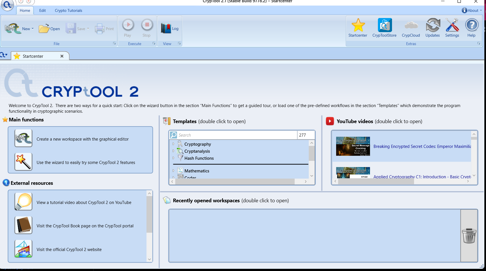
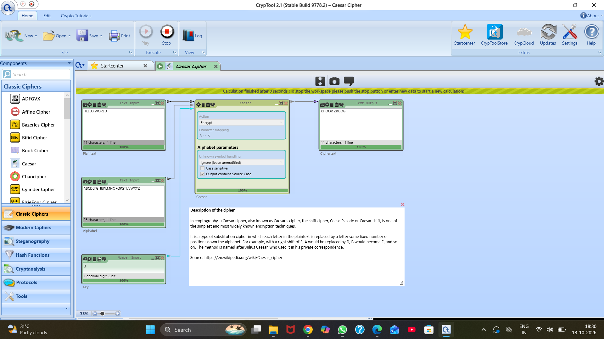
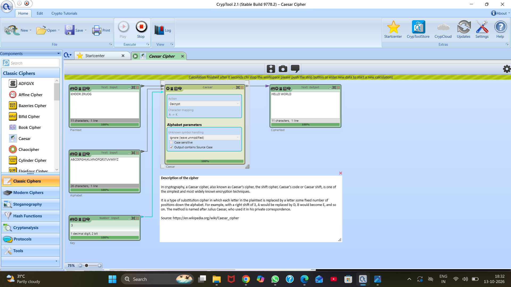
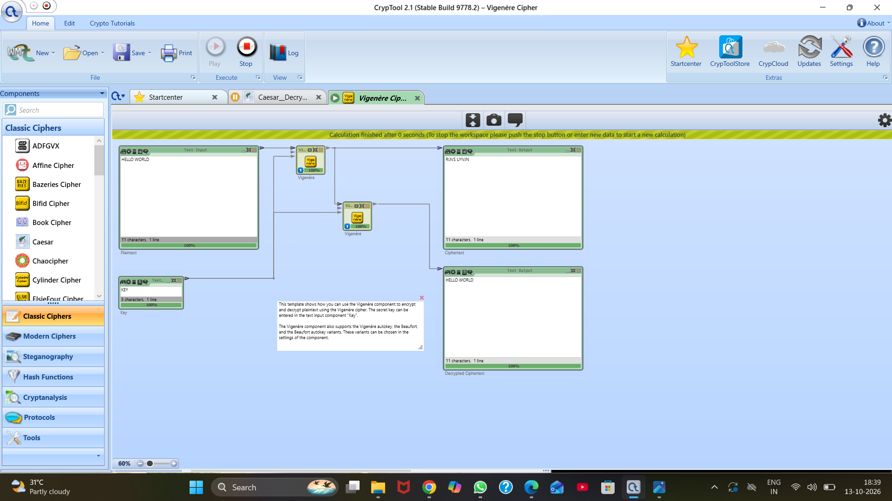
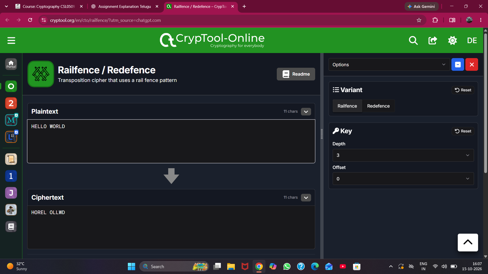
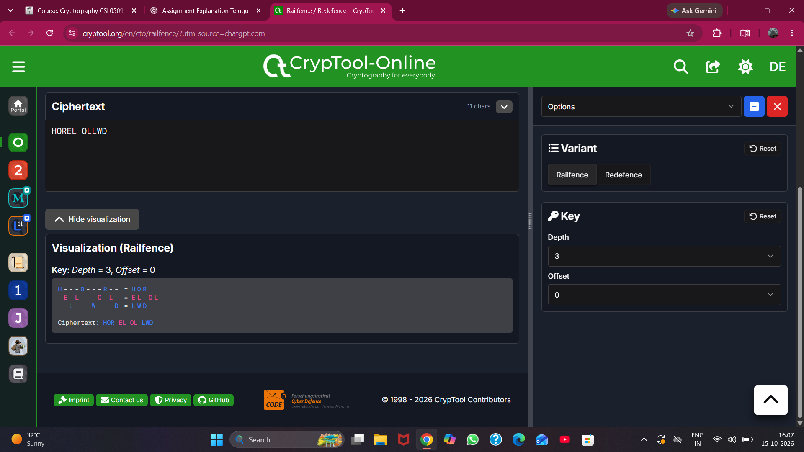
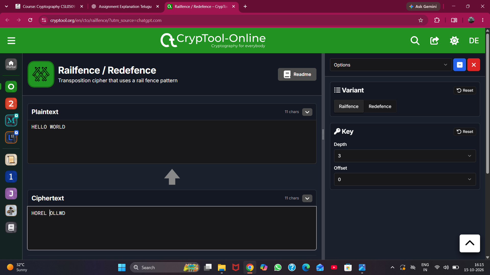

# Experiment 1: Caesar, Vigenère and Rail Fence Ciphers

| Detail | Information |
|---|---|
| Student | k vijay krishna prasad |
| Course | Cryptography |
| Course code | CSL0509 |
| Programme | B.Tech AIML, V Semester |
| Faculty | Mr. Hirendra Singh Sengar |
| Academic year | 2026–27 |

## 1. Aim

To encrypt and decrypt the plaintext `HELLO WORLD` using Caesar, Vigenère and Rail Fence ciphers in CrypTool, and compare their working principles and effectiveness.

## 2. Tools and environment

- Windows computer.
- CrypTool 2.1, Stable Build 9778.2: desktop setup, Caesar implementation, and Vigenère implementation.
- CrypTool-Online, Railfence / Redefence application: Rail Fence implementation.

## 3. Basic concepts

- **Plaintext:** The original readable message.
- **Ciphertext:** The encrypted message.
- **Encryption:** Converting plaintext into ciphertext using an algorithm and key.
- **Decryption:** Recovering plaintext from ciphertext using the corresponding key.
- **Substitution:** Replacing letters with other letters.
- **Transposition:** Rearranging character positions while preserving the characters.

For the formulas below, letters use the values A = 0, B = 1, …, Z = 25. “mod 26” wraps values around the alphabet.

## 4. Part A — Caesar cipher

### Principle and algorithm

Caesar is a monoalphabetic substitution cipher. Every letter is shifted by the same number of alphabet positions.

- Encryption: `C = (P + k) mod 26`
- Decryption: `P = (C - k) mod 26`

Here, `P` is a plaintext letter value, `C` is a ciphertext letter value, and `k` is the shift.

1. Read the input text and shift `k`.
2. Convert each alphabetic character to its numeric value.
3. Add `k` for encryption or subtract `k` for decryption, modulo 26.
4. Convert the value back to a letter.
5. Leave spaces unchanged for this experiment.
6. Combine the characters to obtain the output.

### Working procedure

1. Open the Caesar Cipher workspace in CrypTool 2.
2. Enter `HELLO WORLD` in the text input component.
3. Use the alphabet `ABCDEFGHIJKLMNOPQRSTUVWXYZ`.
4. Enter `3` in the number input connected to the key.
5. Set **Action** to **Encrypt**. Keep unknown symbols unchanged so the space is preserved.
6. Run the workspace and record `KHOOR ZRUOG`.
7. Replace the input with `KHOOR ZRUOG` and set **Action** to **Decrypt**.
8. Use the same key, run the workspace, and verify the recovered text `HELLO WORLD`.

### Observed results

| Parameter | Value |
|---|---|
| Plaintext | `HELLO WORLD` |
| Key | Shift 3 |
| Ciphertext | `KHOOR ZRUOG` |
| Decrypted text | `HELLO WORLD` |
| Space handling | Preserved in its original position |

For example, H → K, E → H, L → O, O → R, and W → Z during encryption.

### Observation

The original plaintext was recovered using the same shift. Caesar is easy to implement, but its small key space and preserved letter-frequency pattern make it vulnerable to exhaustive shift testing and frequency analysis.

## 5. Part B — Vigenère cipher

### Principle and algorithm

Vigenère is a polyalphabetic substitution cipher. A keyword supplies a sequence of shifts, instead of using one fixed shift for every letter.

- Encryption: `C_i = (P_i + K_i) mod 26`
- Decryption: `P_i = (C_i - K_i) mod 26`

Here, `K_i` is the alphabet value of the keyword letter aligned with plaintext letter `P_i`.

1. Read the plaintext and keyword.
2. Repeat the keyword over the alphabetic characters of the message.
3. Add the corresponding keyword value modulo 26 to encrypt each letter.
4. Subtract the corresponding keyword value modulo 26 to decrypt each letter.
5. Handle spaces according to the selected tool settings and record those settings.

### Working procedure

1. Open the Vigenère Cipher template in CrypTool 2.
2. Enter `HELLO WORLD` in the plaintext input and `KEY` in the key input.
3. Use the first Vigenère component for encryption and connect its output to the ciphertext display and the second Vigenère component.
4. Use the second component for decryption, with the same `KEY` input, and connect its output to the decrypted-text display.
5. Run the workspace. The ciphertext display shows `RIJVS UYVJN`.
6. Verify that the decrypted-text display shows `HELLO WORLD`.
7. Capture the complete workspace showing the plaintext, key, ciphertext, and decrypted text together.

### Observed results

| Parameter | Value |
|---|---|
| Plaintext | `HELLO WORLD` |
| Keyword | `KEY` |
| Ciphertext | `RIJVS UYVJN` |
| Decrypted text | `HELLO WORLD` |
| Space handling | Preserved; the observed result matches advancing the keyword over letters only |

The following alignment reproduces the observed ciphertext. The space is preserved between the two words and does not consume a keyword letter.

| Item | 1 | 2 | 3 | 4 | 5 | 6 | 7 | 8 | 9 | 10 |
|---|---|---|---|---|---|---|---|---|---|---|
| Plaintext letters | H | E | L | L | O | W | O | R | L | D |
| Repeated keyword | K | E | Y | K | E | Y | K | E | Y | K |
| Ciphertext letters | R | I | J | V | S | U | Y | V | J | N |

For example, H (7) + K (10) = R (17), while L (11) + Y (24) = 35 mod 26 = J (9).

*This single screenshot records both encryption and decryption, together with the keyword and plaintext.*

### Observation and analysis

The decrypted output matches the original plaintext. The keyword supplies different shifts: the two consecutive L letters in HELLO become J and V. Using multiple alphabets reduces the usefulness of a single overall frequency count compared with Caesar. However, a repeating keyword creates patterns; with enough ciphertext, key-length analysis and frequency analysis at each repeating-key position can help recover the message. The short keyword `KEY` is used here for demonstration.

## 6. Part C — Rail Fence cipher

### Principle and encryption algorithm

Rail Fence is a transposition cipher. It writes characters in a zigzag across a chosen number of rails and reads the rails from top to bottom.

1. Read the plaintext, number of rails, and offset.
2. Start at the top rail with offset 0.
3. Place successive characters on successive rails while moving downwards.
4. At the bottom rail, reverse direction and move upwards.
5. Repeat until all characters are placed.
6. Read each rail left to right, from the top rail to the bottom rail.

### Decryption algorithm

1. Reconstruct the zigzag positions using the ciphertext length, rail count, and offset.
2. Count the positions belonging to each rail.
3. Fill those positions with ciphertext characters, rail by rail.
4. Follow the original zigzag path to recover the plaintext.

### Working procedure

1. Open the [CrypTool-Online Railfence application](https://www.cryptool.org/en/cto/railfence/).
2. Select the **Railfence** variant.
3. Set **Depth** to `3` and **Offset** to `0`.
4. Enter `HELLO WORLD`, including the space, in the plaintext box.
5. Record the ciphertext `HOREL OLLWD` and display the visualization.
6. Edit the ciphertext box to enter `HOREL OLLWD`, preserving the space after the fifth character.
7. Verify that the arrow points upwards and the plaintext box displays `HELLO WORLD`.
8. Save the encryption, visualization, and decryption screenshots.

### Character placement

The symbol `␠` below represents the one space in the input. It is explanatory notation, not an extra character to enter in CrypTool.

| Rail / Character position | 1 | 2 | 3 | 4 | 5 | 6 | 7 | 8 | 9 | 10 | 11 |
|---|---|---|---|---|---|---|---|---|---|---|---|
| Rail 1 | H | | | | O | | | | R | | |
| Rail 2 | | E | | L | | ␠ | | O | | L | |
| Rail 3 | | | L | | | | W | | | | D |

- Rail 1: `HOR`
- Rail 2: `EL OL`
- Rail 3: `LWD`
- Concatenated ciphertext: `HOREL OLLWD`

### Observed results

| Parameter | Value |
|---|---|
| Plaintext | `HELLO WORLD` |
| Depth / number of rails | 3 |
| Offset | 0 |
| Ciphertext | `HOREL OLLWD` |
| Decrypted text | `HELLO WORLD` |
| Space handling | Included as a character and transposed |

### Observation

Encryption changed the character order, including the space position. Decryption restored the original message. Since the characters are only rearranged, their counts remain unchanged. Testing plausible rail counts and offsets can reveal the message.

## 7. Comparison of working and effectiveness

| Feature | Caesar | Vigenère | Rail Fence |
|---|---|---|---|
| Cipher category | Monoalphabetic substitution | Polyalphabetic substitution | Transposition |
| Key | Fixed numerical shift | Keyword | Rail count; offset in this tool |
| Operation | Shifts all letters by the same amount | Shifts letters according to the keyword | Rearranges character positions |
| Letter identity | Changes | Changes | Preserved |
| Frequency behavior | Frequency pattern is relabeled | Multiple alphabets spread letter frequencies | Exact character counts are preserved |
| Main weakness | Very small key space and frequency analysis | Repeated-key patterns and key-length analysis | Trial of rail counts/offsets and structural analysis |
| Practical effort | Very simple | Requires keyword alignment | Requires zigzag placement/reconstruction |
| Suitability | Educational use | Educational use | Educational use |

Vigenère can resist simple single-alphabet frequency analysis better than Caesar, particularly with a longer keyword. Its effectiveness still depends on the key and available ciphertext. None of these classical ciphers provides adequate protection for modern sensitive communications. No timing benchmark was performed in this record.

## 8. Result and conclusion

All three ciphers successfully encrypted and decrypted the assigned plaintext. The recovered message matched `HELLO WORLD` in every case, including its space.

| Cipher | Key/settings | Observed ciphertext | Recovered plaintext | Verification |
|---|---|---|---|---|
| Caesar | Shift 3 | `KHOOR ZRUOG` | `HELLO WORLD` | Matches original |
| Vigenère | Keyword `KEY` | `RIJVS UYVJN` | `HELLO WORLD` | Matches original |
| Rail Fence | Depth 3; offset 0 | `HOREL OLLWD` | `HELLO WORLD` | Matches original |

The experiment demonstrates fixed-shift substitution, keyword-based substitution, and transposition. Caesar and Vigenère replace letters, whereas Rail Fence changes their positions. These methods illustrate classical cryptography but are not suitable for protecting modern sensitive data.

## 9. Evidence and upload checklist

The screenshots are original supplied captures, renamed for clear organization. They are linked with relative paths so they display inside this experiment folder on GitHub.

| File inside `screenshots/` | Evidence |
|---|---|
| `01_CrypTool_Setup.png` | CrypTool version and desktop environment |
| `02_Caesar_Encryption.png` | Plaintext, shift 3, and encrypted output |
| `03_Caesar_Decryption.png` | Ciphertext, shift 3, and recovered plaintext |
| `04_Vigenere_Encryption_Decryption.png` | Plaintext, keyword, encrypted output, and recovered plaintext |
| `railfence_encryption.png` | Online tool, depth, offset, plaintext, and ciphertext |
| `railfence_visualization.png` | Zigzag arrangement and rail contents |
| `railfence_decryption.png` | Upward decryption direction and recovered plaintext |

- [x] Tool setup evidence included.
- [x] All three cipher algorithms and working procedures documented.
- [x] Encryption and decryption results verified against supplied screenshots.
- [x] Comparison, observations, and conclusion included.
- [x] All seven referenced screenshots included in this folder.
- [ ] Upload this experiment folder, including its `screenshots` subfolder, to the personal GitHub repository.
- [ ] Preview README.md on GitHub and confirm that every image displays.
- [ ] Submit the repository link after completing all required experiments.

## 10. References

- Faculty-provided Cryptography Laboratory Activity document, Experiment 1.
- [CrypTool 2](https://www.cryptool.org/en/ct2/).
- [CrypTool-Online Railfence / Redefence](https://www.cryptool.org/en/cto/railfence/).
