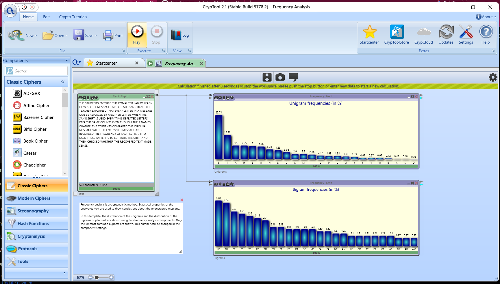
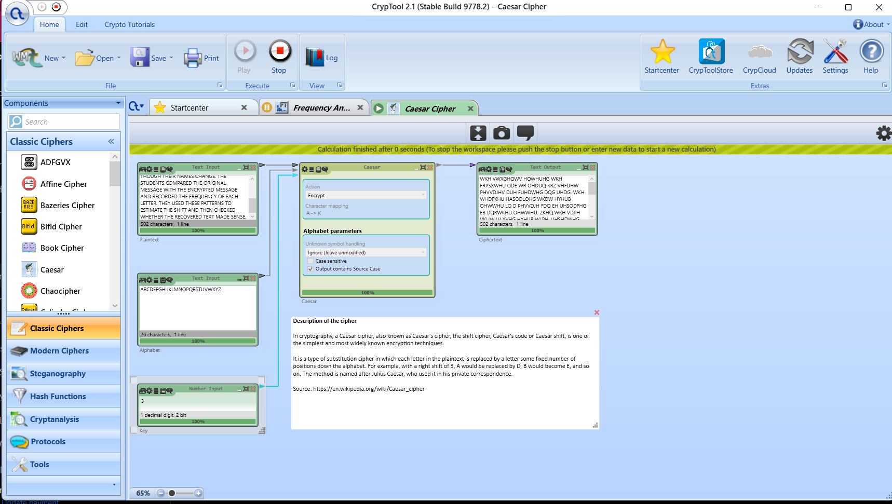
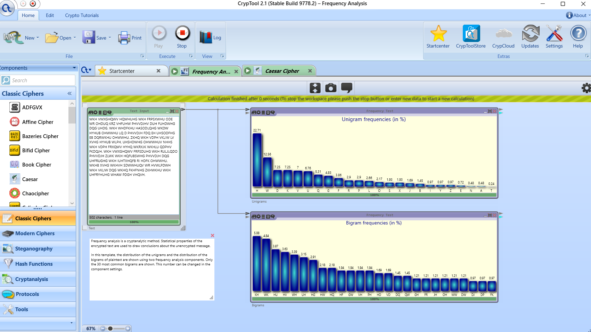
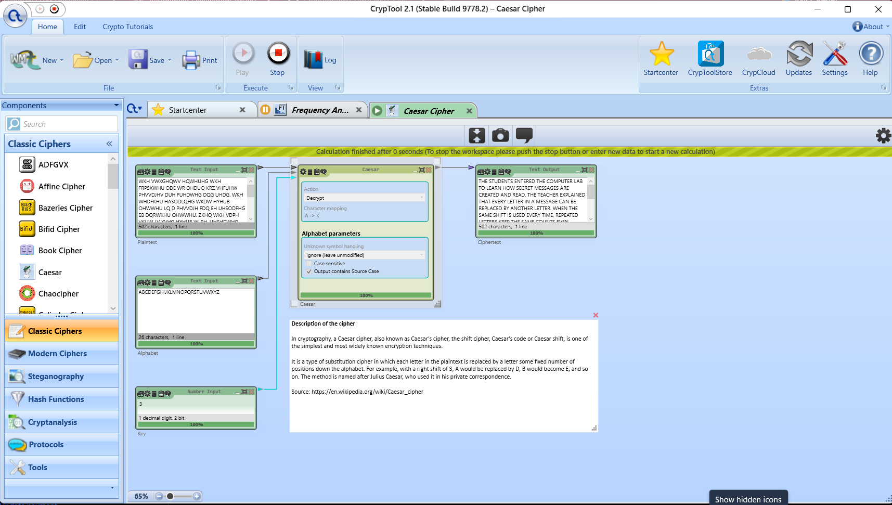

# Experiment 2: Frequency Analysis of Classical Ciphers

| Detail | Information |
|---|---|
| Student | k vijay krishna prasad |
| Course | Cryptography |
| Course code | CSL0509 |
| Programme | B.Tech AIML, V Semester |
| Faculty | Mr. Hirendra Singh Sengar |
| Academic year | 2026–27 |

## 1. Aim

To use CrypTool to examine letter and bigram frequencies, demonstrate the vulnerability of the Caesar cipher to frequency analysis, and discuss how classical cipher designs affect cryptanalysis.

**Practical scope:** This experiment uses a controlled Caesar-cipher example with shift 3. Plaintext and ciphertext distributions are compared, a candidate key is inferred from a ciphertext frequency clue, and decryption is used to check that candidate. The original key is known during setup; this is a demonstration of the method rather than an independent recovery of an unknown key. Vigenère and Rail Fence are discussed theoretically in Section 9.

## 2. Tools and setup

- Windows computer.
- CrypTool 2.1, Stable Build 9778.2.
- **Frequency Analysis** template with Text Input connected to unigram and bigram Frequency Test components.
- **Caesar Cipher** template with text, alphabet and numerical key inputs.
- Alphabet: `ABCDEFGHIJKLMNOPQRSTUVWXYZ`.
- Caesar key: `3`.
- Unknown symbol handling: **Ignore (leave unmodified)**; spaces and punctuation remain unchanged.

The screenshots below show the actual CrypTool workspace, settings and results.

## 3. Theory and algorithm

A unigram is one letter; a bigram is a pair of consecutive letters. English letters are not equally common. Frequency analysis uses this uneven distribution to propose plaintext–ciphertext mappings.

For a letter x:

```text
Frequency(x) = Count(x) / Total number of analyzed letters × 100
```

The Caesar cipher applies the same shift to every letter. With A = 0, B = 1, …, Z = 25:

```text
Encryption: C = (P + k) mod 26
Decryption: P = (C - k) mod 26
```

A fixed substitution changes letter names but preserves their counts. Thus, a peak for E in the plaintext becomes a peak for H when k = 3.

### Frequency-analysis procedure

1. Count ciphertext letters and calculate relative frequencies.
2. Identify frequent letters and repeated bigrams.
3. Propose mappings to likely English letters, such as E or T.
4. For Caesar, calculate a candidate shift from a proposed mapping.
5. Decrypt with the candidate shift.
6. Check readability and, in this controlled experiment, compare with the original message. If the candidate fails, try other mappings or shifts.

The most frequent letter is **not guaranteed** to be E. Message length, language and subject matter affect frequencies; decryption must verify the hypothesis.

## 4. Input data

### Plaintext

```text
THE STUDENTS ENTERED THE COMPUTER LAB TO LEARN HOW SECRET MESSAGES ARE CREATED AND READ. THE TEACHER EXPLAINED THAT EVERY LETTER IN A MESSAGE CAN BE REPLACED BY ANOTHER LETTER. WHEN THE SAME SHIFT IS USED EVERY TIME, REPEATED LETTERS KEEP THE SAME COUNTS EVEN THOUGH THEIR NAMES CHANGE. THE STUDENTS COMPARED THE ORIGINAL MESSAGE WITH THE ENCRYPTED MESSAGE AND RECORDED THE FREQUENCY OF EACH LETTER. THEY USED THESE PATTERNS TO ESTIMATE THE SHIFT AND THEN CHECKED WHETHER THE RECOVERED TEXT MADE SENSE.
```

The message contains **502 characters**, including spaces and punctuation, and **414 alphabetic letters**. CrypTool's unigram percentages match counts normalized over those 414 letters. The bigram results match overlapping pairs after removing spaces and punctuation, giving 413 pairs.

### Caesar ciphertext, k = 3

```text
WKH VWXGHQWV HQWHUHG WKH FRPSXWHU ODE WR OHDUQ KRZ VHFUHW PHVVDJHV DUH FUHDWHG DQG UHDG. WKH WHDFKHU HASODLQHG WKDW HYHUB OHWWHU LQ D PHVVDJH FDQ EH UHSODFHG EB DQRWKHU OHWWHU. ZKHQ WKH VDPH VKLIW LV XVHG HYHUB WLPH, UHSHDWHG OHWWHUV NHHS WKH VDPH FRXQWV HYHQ WKRXJK WKHLU QDPHV FKDQJH. WKH VWXGHQWV FRPSDUHG WKH RULJLQDO PHVVDJH ZLWK WKH HQFUBSWHG PHVVDJH DQG UHFRUGHG WKH IUHTXHQFB RI HDFK OHWWHU. WKHB XVHG WKHVH SDWWHUQV WR HVWLPDWH WKH VKLIW DQG WKHQ FKHFNHG ZKHWKHU WKH UHFRYHUHG WHAW PDGH VHQVH.
```

The complete ciphertext above is reproduced by applying shift 3 to the supplied plaintext. Its length remains 502 characters.

## 5. Experimental procedure and screenshots

### A. Analyze the plaintext

1. Open CrypTool and use the Startcenter template search to find **Frequency Analysis**.
2. Open the template and replace its sample text with the plaintext in Section 4.
3. Click **Play**.
4. Observe the unigram and bigram frequency charts.

**Observation:** E is the most frequent letter at 22.71%, followed by T at 12.56%. HE and TH are the two leading bigrams at 5.08% and 4.84%.



### B. Encrypt with Caesar

1. Open the **Caesar Cipher** template.
2. Paste the same plaintext into Text Input.
3. Set the alphabet to A–Z and the numerical key to **3**.
4. Set **Action → Encrypt** and retain spaces and punctuation.
5. Click **Play** and copy the output ciphertext.

**Observation:** The message begins `WKH VWXGHQWV HQWHUHG WKH FRPSXWHU ODE`, corresponding to `THE STUDENTS ENTERED THE COMPUTER LAB`.



### C. Analyze the ciphertext

1. Return to the **Frequency Analysis** template.
2. Stop execution if necessary and replace Text Input with the Caesar ciphertext.
3. Click **Play**.
4. Compare the letter labels and percentages with the plaintext chart.

**Observation:** H is most frequent at 22.71%, followed by W at 12.56%. The frequency values are preserved while the labels shift by three positions. The displayed charts are sorted by frequency; their matching bar heights demonstrate this preservation.



### D. Infer a candidate key and verify decryption

The most frequent ciphertext letter is H. Hypothesizing that it corresponds to E gives:

```text
E = 4, H = 7
Candidate key = (7 - 4) mod 26 = 3
```

The second frequent mapping, T → W, supports the same shift:

```text
T = 19, W = 22
Candidate key = (22 - 19) mod 26 = 3
```

1. Return to the Caesar template and paste the ciphertext into Text Input.
2. Set **Action → Decrypt** and key **3**.
3. Click **Play**.
4. Check that the output is readable English and matches the original message.

**Observation:** The output begins `THE STUDENTS ENTERED THE COMPUTER LAB TO LEARN HOW SECRET MESSAGES ARE CREATED AND READ.` Both input and output show 502 characters.

> The template's fixed captions may still say “Plaintext” beneath the input and “Ciphertext” beneath the output. With Action set to Decrypt, the input is ciphertext and the output is recovered plaintext.



## 6. Observations and calculations

### Selected unigram frequencies

The percentages are shown in the screenshots; counts are calculated from the supplied plaintext. The corresponding ciphertext letters have identical counts.

| Plaintext letter | Ciphertext letter | Count in each text | Plaintext frequency | Ciphertext frequency |
|---|---|---:|---:|---:|
| E | H | 94 | 22.71% | 22.71% |
| T | W | 52 | 12.56% | 12.56% |
| A | D | 30 | 7.25% | 7.25% |
| H | K | 30 | 7.25% | 7.25% |
| S | V | 29 | 7.00% | 7.00% |
| R | U | 28 | 6.76% | 6.76% |
| N | Q | 22 | 5.31% | 5.31% |
| D | G | 20 | 4.83% | 4.83% |

For example:

```text
Frequency(E) in plaintext = 94 / 414 × 100 = 22.71%
Frequency(H) in ciphertext = 94 / 414 × 100 = 22.71%
```

### Selected bigram frequencies

| Plaintext bigram | Ciphertext bigram | Count in each normalized text | Frequency in each text |
|---|---|---:|---:|
| HE | KH | 21 | 5.08% |
| TH | WK | 20 | 4.84% |
| ER | HU | 16 | 3.87% |
| ES | HV | 15 | 3.63% |
| TE | WH | 14 | 3.39% |
| RE | UH | 13 | 3.15% |

Bigrams provide additional evidence: HE → KH and TH → WK are consistent with a shift of 3. Removing spaces before forming pairs means some analyzed pairs span word boundaries.

## 7. Result

| Check | Outcome |
|---|---|
| Plaintext frequency analysis | Unigram and bigram charts generated |
| Caesar encryption | Ciphertext generated with key 3 |
| Ciphertext frequency analysis | Frequencies preserved under shifted labels |
| Candidate shift from H → E | 3 |
| Decryption verification | Readable original message recovered in CrypTool |
| Message length | 502 characters before and after encryption/decryption |

The experiment demonstrates that Caesar encryption preserves statistical patterns that can reveal its shift. A likely key of **3** was supported by unigram and bigram mappings and checked through decryption.

## 8. Limitations

- This was a controlled demonstration using a known setup, not a blind cryptanalytic challenge.
- The selected paragraph has E at 22.71%; this is a property of this sample, not a universal English frequency.
- Short or unusual messages can make frequency guesses unreliable.
- Equal message lengths alone do not establish correct decryption; the recovered content must also be checked.
- Caesar has only 26 possible shifts, including the identity shift, so exhaustive search is also practical.

## 9. Security comparison of classical ciphers

This table explains the theory; only the Caesar frequency-analysis workflow was executed for this experiment.

| Cipher | Effect on frequencies | Cryptanalytic implication |
|---|---|---|
| Caesar | One fixed shift preserves each letter's count under a new label | Frequency clues can suggest the shift; the small key space also permits exhaustive search |
| General monoalphabetic substitution | Each plaintext letter always maps to one ciphertext letter | Frequency ranks and repeated patterns provide clues, although recovering the full mapping requires more work |
| Repeating-key Vigenère | Different key positions can map the same plaintext letter differently | Whole-text unigram analysis is less direct; after estimating the key period, each position group can be analyzed as a Caesar stream |
| Rail Fence | Rearranges positions while preserving individual letter counts | Unigrams do not directly identify the rail count; rearrangement changes adjacency and reconstruction depends on the transposition pattern |

## 10. Conclusion

Frequency analysis exposes information that a fixed substitution leaves visible. In this experiment, E → H and T → W retained their frequencies, while HE → KH and TH → WK supplied supporting bigram evidence. Decryption with shift 3 recovered readable plaintext, illustrating why the Caesar cipher is unsuitable for protecting sensitive information.

## 11. Evidence files

| File | Evidence |
|---|---|
| `screenshots/01_Plaintext_Frequency_Analysis.png` | CrypTool setup and plaintext charts |
| `screenshots/02_Caesar_Encryption.png` | Encryption action, key 3 and ciphertext |
| `screenshots/03_Ciphertext_Frequency_Analysis.png` | Ciphertext unigram and bigram charts |
| `screenshots/04_Caesar_Decryption_Verification.png` | Decryption action, key 3 and recovered text |
