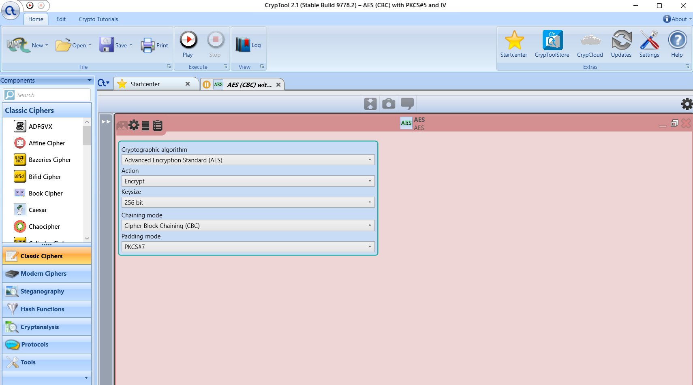
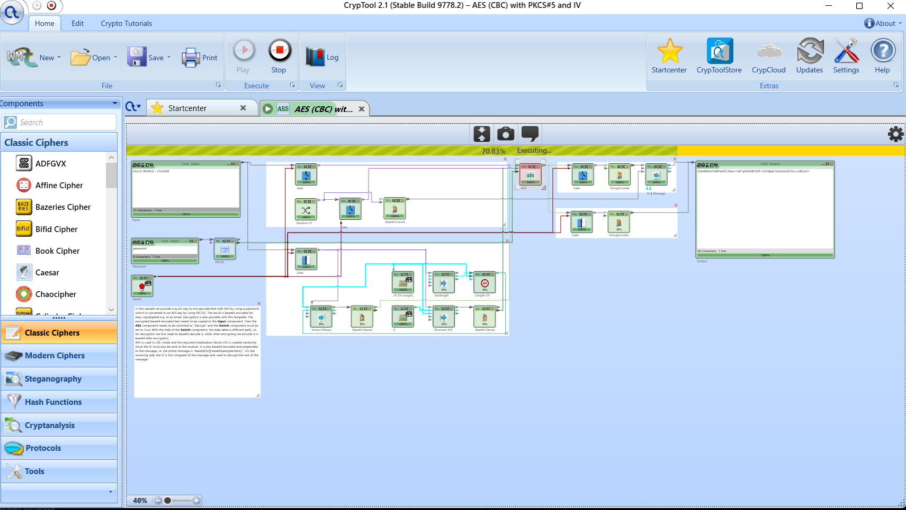
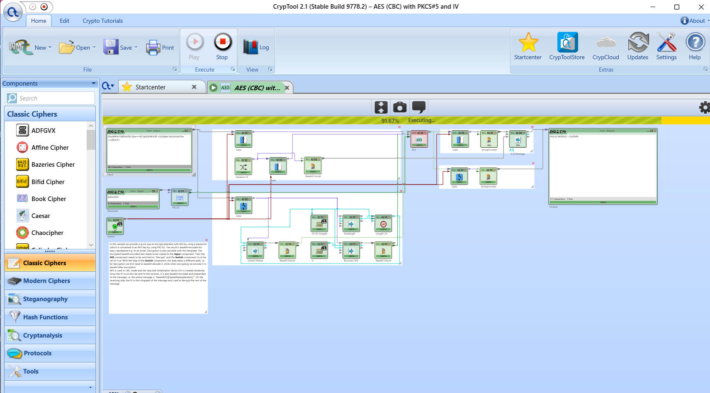
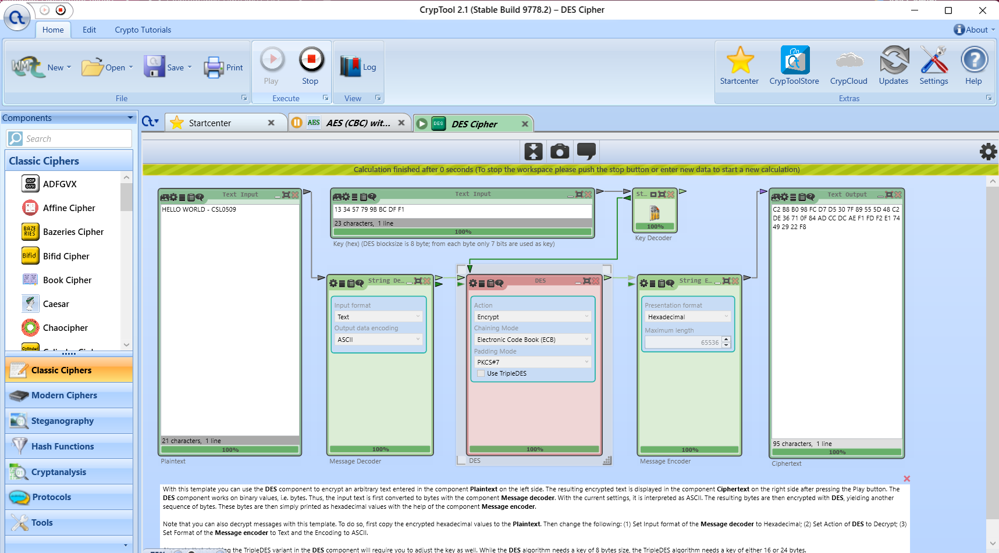
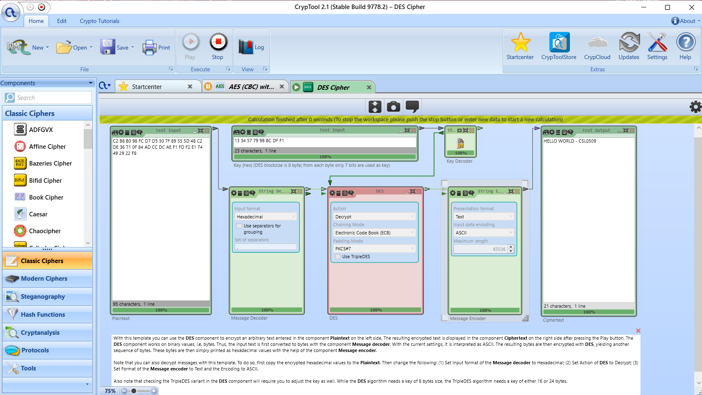

# Experiment 3: DES and AES Comparison

| Detail | Information |
|---|---|
| Student | k vijay krishna prasad |
| Course | Cryptography — CSL0509 |
| Programme | B.Tech AIML, V Semester |
| Faculty | Mr. Hirendra Singh Sengar |
| Academic year | 2026–27 |
| Practical software | CrypTool 2.1, Stable Build 9778.2, Windows |
| Screenshot date | 17 October 2026 |

**Evidence status:** AES and DES encryption/decryption were verified from five supplied CrypTool screenshots. Both recovered the original message. A supplemental OpenSSL benchmark is available. Both saved `.cwm` workspaces are included. Controlled CrypTool performance measurements remain pending.

## Aim

Encrypt and decrypt the same message using DES and AES, compare their security properties, and distinguish functional results from measured performance.

## Saved CrypTool workspaces

- [AES_CBC_Demo.cwm](AES_CBC_Demo.cwm)
- [DES_ECB_Demo.cwm](DES_ECB_Demo.cwm)

These are the original user-supplied workspace files, preserved byte-for-byte. Their gzip/XML structure was checked before upload; they were not reopened or executed in the preparation environment. Download them and open them in CrypTool 2.1. The screenshots below record the observed practical runs.

## Plaintext

```text
HELLO WORLD - CSL0509
```

Both decryption screenshots display this message and **21 characters**.

## Actual practical settings

| Setting | AES demonstration | DES demonstration |
|---|---|---|
| Startcenter template | AES (CBC) with PKCS#5 and IV | DES Cipher |
| Algorithm | AES, 256-bit key setting | DES; Use TripleDES unchecked |
| Key input | Demo password `password`, processed by the template's PKCS#5 component | Hex `13 34 57 79 9B BC DF F1` |
| Chaining mode | CBC | ECB |
| Padding mode | PKCS#7 | PKCS#7 |
| IV | Random IV supplied by the template | Not used in ECB |
| Ciphertext display | Template packages Base64 IV and Base64 ciphertext | Hexadecimal |
| Recovered text | HELLO WORLD - CSL0509 | HELLO WORLD - CSL0509 |

The password and DES key are public lab examples. The AES key is derived by the template; no raw AES key was entered manually. The template title's PKCS#5 component handles the password, while the AES settings explicitly show PKCS#7 padding. Exact key-derivation parameters were not captured and are not assumed.

The demonstrations use different modes and key preparation, so their GUI execution times are not a controlled cipher-speed comparison.

## Part A — AES procedure

1. Open **AES (CBC) with PKCS#5 and IV** from Startcenter.
2. Replace Input with the plaintext above. Keep the demonstration Password as `password`.
3. Select AES Action **Encrypt**, Keysize **256 bit**, Chaining mode **CBC**, and Padding mode **PKCS#7**.
4. Keep the template Switch in its encryption state (`False`) and press **Play**.
5. Save the complete Text Output before changing the workflow. The screenshot shows **68 output characters**; the template includes the IV in its output package.
6. Press **Stop**, paste the copied encrypted output into Input, and keep the same password.
7. Change AES Action to **Decrypt**, set Switch to **True**, and press **Play**.
8. Verify recovery of the original 21-character message.

### AES settings



### AES encryption



### AES decryption



## Part B — DES procedure

1. Search Startcenter for **DES** and open **DES Cipher**.
2. Enter the same plaintext in the left Text Input box.
3. Set Key (hex) to `13 34 57 79 9B BC DF F1`.
4. In Message Decoder, select **Text** and **ASCII**.
5. In DES, select **Encrypt**, **Electronic Code Book (ECB)** and **PKCS#7**; leave **Use TripleDES** unchecked.
6. Set Message Encoder Presentation format to **Hexadecimal** and press **Play**.
7. Save the ciphertext, press **Stop**, and paste the complete ciphertext into the left input box.
8. Set Message Decoder Input format to **Hexadecimal**, DES Action to **Decrypt**, and Message Encoder Presentation format to **Text**, with **ASCII** encoding.
9. Keep the key, mode and padding unchanged. Press **Play** and verify the original 21-character message.

### DES encryption



### DES decryption



## Algorithm and security comparison

Both are symmetric block ciphers. DES uses a 16-round Feistel structure. AES uses substitution, row shifting, column mixing and round-key addition; the final round omits column mixing.

| Property | DES | AES |
|---|---|---|
| Block size | 64 bits | 128 bits |
| Effective key size | 56 bits; 64-bit representation includes parity bits | 128, 192 or 256 bits |
| Rounds | 16 | 10, 12 or 14; 14 for AES-256 |
| Security | Small key space makes DES obsolete for sensitive data | Much larger key space; mode and key management also matter |
| Mode observed here | ECB | CBC |

ECB reveals repeated plaintext blocks as repeated ciphertext blocks under the same key. CBC uses an IV and chaining, but does not itself authenticate messages. Neither demonstration provides an integrity check. Authenticated encryption such as AES-GCM is used in [Experiment 8](../Exp08_AES_Text_App/README.md).

## Matched timing workspaces and observed runs

[Download the matched DES/AES timing workspaces and follow the run guide](timing/README.md). Both workspaces with the same 8 MiB input and ECB mode completed in Windows CrypTool. Three additional screenshots in the guide document the DES run, DES log and AES-256 run. Both completion messages display `0 seconds`, leaving precise durations and a controlled speed comparison unresolved.

## Performance observations

The matched 8 MiB DES and AES-256 runs both show **Calculation finished after 0 seconds** and components at 100%. This display does not resolve their actual processing durations and is not evidence of zero processing time. The DES log shows zero errors and one output-preview truncation warning. The AES log was not captured. No CrypTool speed ranking is inferred from these captures.

### Separate OpenSSL benchmark

The existing Linux preparation run used the same **1 MiB input**, CBC mode and five measured encryption trials per cipher, with successful exact decryption checks.

| Cipher | Median time (ms) | Trials | Round trip |
|---|---:|---:|---|
| DES-CBC | 22.254 | 5 | Passed |
| AES-128-CBC | 5.603 | 5 | Passed |
| AES-256-CBC | 5.148 | 5 | Passed |

These timings include process startup and file I/O. They belong to **OpenSSL, not CrypTool**. Both AES configurations were faster than DES in this particular run; that is not a universal ranking, and speed does not establish security.

Reproduce the supplemental run from the repository root:

```powershell
python Exp03_DES_AES/openssl_comparison.py
```

[Benchmark CSV](results/benchmark.csv) · [Full execution log](results/execution.txt) · [Machine-readable OpenSSL results](results/summary.json)

The supplemental JSON's `cryptool_executed: false` describes that script's scope. The separate Windows CrypTool evidence consists of the five practical screenshots above and three initial timing-run screenshots in the linked guide.

The image below is a **rendered execution-log extract**, not an application screenshot:


## Conclusion

The screenshots demonstrate successful AES-256-CBC and DES-ECB encryption/decryption of the same message. Both recover the original text. AES offers a substantially larger key space than DES. The separate OpenSSL benchmark supplies measured results with stated limits; a controlled CrypTool performance comparison remains to be recorded.

## Completion checklist

- [x] AES settings screenshot
- [x] AES encryption and decryption screenshots
- [x] DES encryption and decryption screenshots
- [x] Security comparison and supplemental benchmark documentation
- [x] Upload actual saved `AES_CBC_Demo.cwm` and `DES_ECB_Demo.cwm` files
- [ ] Record controlled CrypTool timing with the same larger input and mode, one warm-up and five measured runs per algorithm; document machine, input size, padding, key preparation and timer resolution

## References

- [CrypTool function catalogue](https://www.cryptool.org/en/functions/)
- [OpenSSL enc](https://docs.openssl.org/3.0/man1/openssl-enc/)
