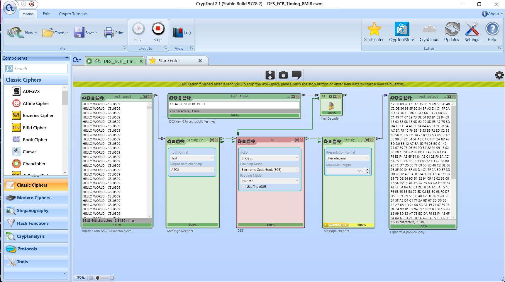
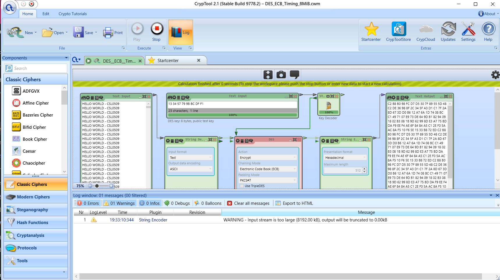
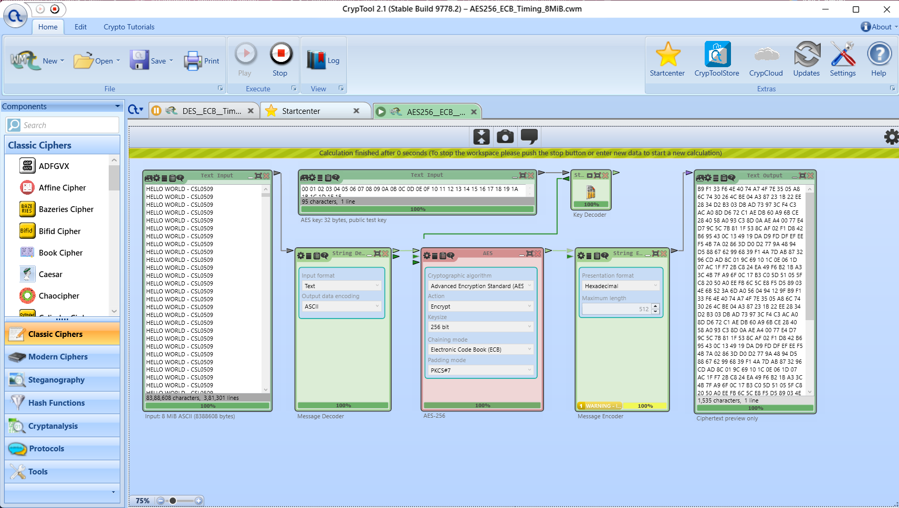

# CrypTool timing comparison — observed runs

**Status: both workspaces opened and completed on the user’s Windows CrypTool 2.1 Stable Build 9778.2 on 17 October 2026. Both displayed `0 seconds`; this does not resolve their processing times. Five measured trials and a valid speed comparison remain pending.**

These derived workspaces use the user's working DES graph and AES component metadata. The original `AES_CBC_Demo.cwm` and `DES_ECB_Demo.cwm` remain unchanged.

## Observed initial runs

| Workspace | Input | Completion display | Interpretation |
|---|---:|---|---|
| DES-ECB | 8,388,608 ASCII characters | 0 seconds; components at 100% | Duration unresolved by the visible timer |
| AES-256-ECB | 8,388,608 ASCII characters | 0 seconds; components at 100% | Duration unresolved by the visible timer |

These are initial compatibility/warm-up observations, not five measured trials. No median, precise time, throughput or speed ranking is inferred. CPU and RAM have not been recorded.

The DES log shows **0 Errors and 1 Warning**, from String Encoder truncating the output preview. Its timestamp is a clock time, not elapsed duration. The AES screenshot shows one String Encoder warning, but its log panel is not open, so the exact message and total error count were not captured. Both screenshots show ciphertext previews; these do not prove full 8 MiB round-trip recovery.







**Next measurement requirement:** use a verified higher-resolution CrypTool timing method, or a matched workload with a clearly resolved duration, before collecting five measured runs. Repeating the same unresolved display does not establish a comparison.

## Download and run

- [DES_ECB_Timing_8MiB.cwm](DES_ECB_Timing_8MiB.cwm)
- [AES256_ECB_Timing_8MiB.cwm](AES256_ECB_Timing_8MiB.cwm)

On each GitHub file page, use **Download raw file**, then open the downloaded `.cwm` using CrypTool **Open**. Do not save the GitHub HTML page as a workspace.

1. Open the DES timing workspace first. It contains 8 MiB of ASCII input, so initial loading can take longer than the short demo. Wait until the workspace has loaded.
2. Check that the DES action is **Encrypt**, mode **ECB**, padding **PKCS#7**, and TripleDES is unchecked. The plaintext input should have **8,388,608 characters**.
3. Press **Play** once for a warm-up. Wait for calculation completion and check for errors. Capture the full window, including the completion message and output preview, and send it for review before taking measured runs.
4. Press **Stop**, then repeat **Play → completion → record time → Stop** five times. Do not count the warm-up or file-loading time. Keep the input and settings unchanged.
5. Open the AES timing workspace and check **AES**, **256-bit key**, **Encrypt**, **ECB**, **PKCS#7**, and the same input size. Repeat one warm-up and five measured runs.
6. Capture the visible duration for every measured run. Record units exactly as displayed. Also record the CPU, RAM, Windows version and CrypTool version/build.
7. If the display rounds to `0 seconds`, record **below display resolution**, not a measured zero. Stop and report this; a larger matched workload or higher-resolution timing method is needed before claiming a speed ranking.

Both derived files have now opened and completed in the user’s Windows CrypTool. The preparation environment only validated their gzip/XML structure. For any future modified workload, check compatibility and errors again before collecting measurements.

## Controlled settings

| Variable | DES | AES |
|---|---|---|
| Input | Same 8 MiB ASCII text | Same 8 MiB ASCII text |
| Action | Encrypt | Encrypt |
| Mode | ECB | ECB |
| Padding | PKCS#7 | PKCS#7 |
| Key preparation | Raw hexadecimal test key | Raw hexadecimal test key |
| Key | 13 34 57 79 9B BC DF F1 | Bytes 00 through 1F (32 bytes) |
| IV/password derivation | None | None |
| Output | Hexadecimal preview, limited to 512 input bytes at encoder | Same preview limit |
| Warm-up / measured runs | 1 / 5 | 1 / 5 |

ECB is used here only to match the two educational workloads. It is not a recommendation for protecting real messages. The AES timing workspace is separate from the earlier AES-CBC password demonstration.

A String Encoder warning that the output is truncated is expected: only the first 512 ciphertext bytes are shown, after the encoder waits for the stream to finish. This preview warning alone is not an encryption failure. Other errors must be reviewed before recording a time.

The reported duration is for the **whole CrypTool workflow**, including conversion, scheduling and limited output rendering. It is not isolated cipher time. The output is deliberately a preview and is not a full ciphertext export or a large-input round-trip verification. Successful short-message round trips are documented separately in the experiment README.

## Results to collect

| Run | DES duration and unit | AES-256 duration and unit |
|---|---|---|
| Initial run — exclude | Displayed 0 seconds; unresolved | Displayed 0 seconds; unresolved |
| 1 | Pending | Pending |
| 2 | Pending | Pending |
| 3 | Pending | Pending |
| 4 | Pending | Pending |
| 5 | Pending | Pending |
| Median of measured runs | Pending | Pending |

Compare medians only when both workflows finish without errors and times are resolved by the timer. A speed difference on one machine does not establish universal performance or cryptographic security.

## Rebuild and provenance

From the repository root, with Python 3:

```powershell
python Exp03_DES_AES/timing/build_workspaces.py
```

This generates prepared workspaces and a preparation manifest; it does not execute CrypTool or generate results. The source workspaces are the originals uploaded by the user. Generated inputs are identical and are checked by byte length and SHA-256. `preparation_manifest.json` records their preparation status and file hashes.

Setting values were checked against the supplied workspaces and the official CrypTool source:

- [AES settings](https://github.com/CrypToolProject/CrypTool-2/blob/main/CrypPlugins/AES/AESSettings.cs)
- [String Decoder settings](https://github.com/CrypToolProject/CrypTool-2/blob/main/CrypPlugins/StringDecoder/StringDecoderSettings.cs)
- [String Encoder settings](https://github.com/CrypToolProject/CrypTool-2/blob/main/CrypPlugins/StringEncoder/StringEncoderSettings.cs)
