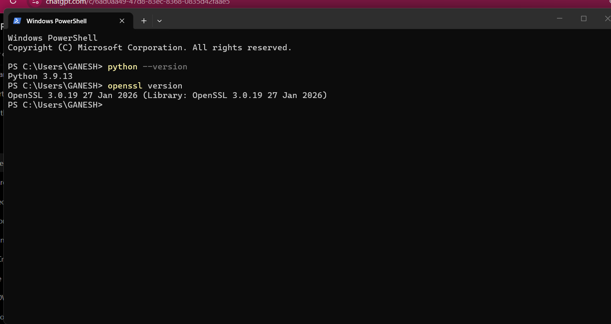
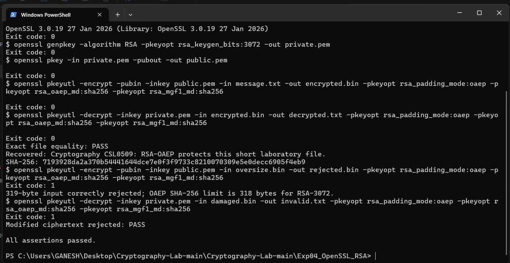
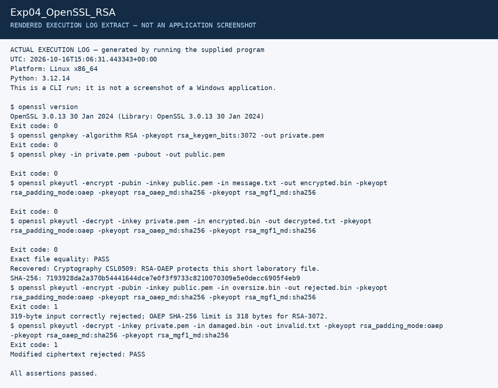

# Experiment 4: RSA File Encryption with OpenSSL

| Detail | Information |
|---|---|
| Student | k vijay krishna prasad |
| Course | Cryptography — CSL0509 |
| Programme | B.Tech AIML, V Semester |
| Faculty | Mr. Hirendra Singh Sengar |
| Academic year | 2026–27 |

**Evidence status:** Implemented and executed in the Linux preparation environment, then successfully run by the student in Windows PowerShell on 17 October 2026. Two original screenshots verify setup, exact recovery and both rejection checks. The required setup/result screenshots are recorded.

## Aim and algorithm

Generate an RSA key pair and encrypt/decrypt a small file with RSA-OAEP. Key generation chooses RSA parameters; the public key encrypts and the private key decrypts. OAEP supplies randomized encoding; textbook RSA is not used for the real file operation.

## Run

Open the repository in VS Code or a terminal. Install Python and OpenSSL if they are not already on PATH, then run from the repository root:

```powershell
openssl version
python Exp04_OpenSSL_RSA/run.py
```

## Working procedure

1. Generate a fresh RSA-3072 private key with `openssl genpkey`.
2. Export its public key with `openssl pkey -pubout`.
3. Create the short synthetic `message.txt`.
4. Encrypt using `openssl pkeyutl -encrypt`, OAEP padding, SHA-256 and MGF1-SHA256.
5. Decrypt with the matching private key and identical OAEP settings.
6. Compare the recovered file byte-for-byte with the input and compute its SHA-256 hash.
7. Confirm that a 319-byte input is rejected and a changed ciphertext fails decryption.

The exact commands and exit codes appear in the execution log. Fresh private keys exist only in a temporary directory and are removed when the script exits. Re-running generates a new key pair and new ciphertext.

## Results

- Exact round trip passed; the encrypted RSA block is 384 bytes.
- Modified ciphertext was rejected.
- The 319-byte message was rejected. RSA-3072 with OAEP/SHA-256 accepts at most `384 - 2×32 - 2 = 318` bytes.
- Public artifacts: [message](results/message.txt), [public key](results/public.pem), [ciphertext](results/encrypted.bin), [recovered file](results/decrypted.txt).

## Interpretation

RSA is suitable for small values such as random symmetric keys. For large files, use hybrid encryption: encrypt the file with AES-GCM and encrypt only the AES key with RSA-OAEP. Splitting an arbitrary file into independently encrypted RSA blocks is not a replacement for a well-designed hybrid format. Encryption alone does not prove who sent a message.

## Student Windows execution and screenshots

Environment shown: **Python 3.9.13**, **OpenSSL 3.0.19 (27 January 2026)**, Windows PowerShell. The result screenshot shows RSA-3072 key generation, RSA-OAEP with SHA-256/MGF1-SHA256 encryption/decryption, and `All assertions passed.`

| Observed check | Result |
|---|---|
| Key generation, public-key export, encryption and decryption | Exit code 0 |
| Recovered file equals original | PASS |
| 319-byte plaintext exceeds the 318-byte OAEP limit | Rejected, expected exit code 1 |
| Modified ciphertext | Rejected, expected exit code 1 |

The exit code 1 entries are intentional negative checks, not a failed experiment.

- [x] OpenSSL/Python setup screenshot
- [x] RSA result screenshot with successful recovery, hash and rejection checks





## Earlier Linux execution artifacts

The files below belong to the earlier Linux preparation run. The student’s Windows run generates fresh keys and ciphertext; its files have not been supplied. The two screenshots above are the evidence of that separate Windows run.

[Full execution log](results/execution.txt) · [Machine-readable results](results/summary.json)

The image below is a **rendered extract of the actual execution log**, not a screenshot of CrypTool, VS Code, Kali or Wireshark.



## References

- [OpenSSL pkeyutl](https://docs.openssl.org/3.0/man1/openssl-pkeyutl/)
