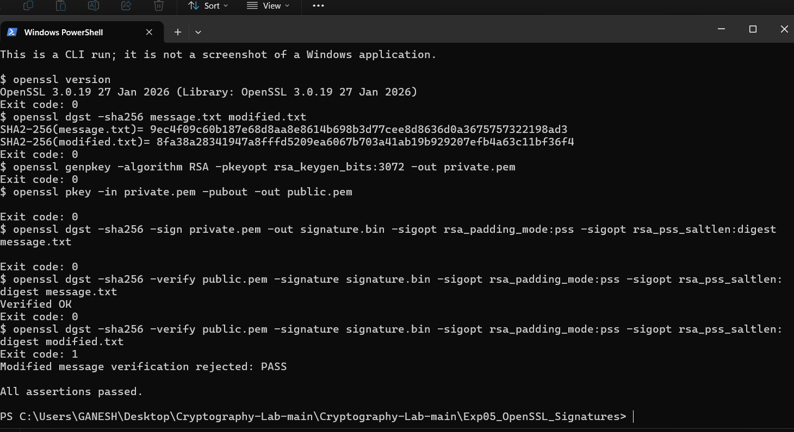
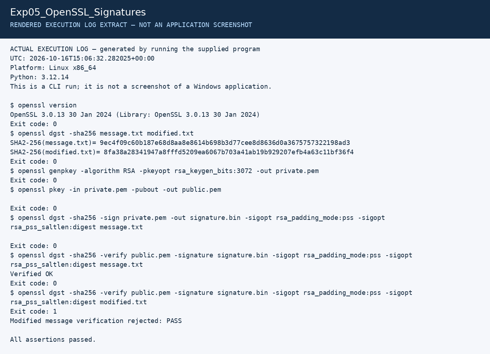

# Experiment 5: SHA-256 and Digital Signatures

| Detail | Information |
|---|---|
| Student | k vijay krishna prasad |
| Course | Cryptography — CSL0509 |
| Programme | B.Tech AIML, V Semester |
| Faculty | Mr. Hirendra Singh Sengar |
| Academic year | 2026–27 |

**Evidence status:** Executed in the Linux preparation environment, then successfully run by the student in Windows PowerShell on 17 October 2026. An original terminal screenshot records OpenSSL 3.0.19, both SHA-256 hashes, successful signature verification and modified-message rejection.

## Aim and algorithm

Hash a message, sign it with RSA-PSS/SHA-256 and verify authenticity and integrity using the corresponding public key.

1. Compute the message digest with SHA-256.
2. Sign using the private RSA key, PSS padding and SHA-256.
3. Verify using the public key and the same scheme.
4. Change the message while retaining its original signature and verify rejection.

## Run

```powershell
openssl version
python Exp05_OpenSSL_Signatures/run.py
```

## Working procedure

The script creates a synthetic approval message, a second version that changes `1` to `2`, a temporary RSA-3072 key pair, and an RSA-PSS signature. It invokes `openssl dgst -sha256` for hashes and uses `-sigopt rsa_padding_mode:pss -sigopt rsa_pss_saltlen:digest` for signing and verifying. All commands are in the recorded log.

You can independently verify the saved valid signature without the private key:

```powershell
cd Exp05_OpenSSL_Signatures/results
openssl dgst -sha256 -verify public.pem -signature signature.bin -sigopt rsa_padding_mode:pss -sigopt rsa_pss_saltlen:digest message.txt
```

Repeat that command with `modified.txt`; verification must fail.

## Results and interpretation

The valid message returned `Verified OK`. The modified message had a different hash and failed signature verification. The hashes and checks are recorded in `summary.json`.

A hash alone provides no sender authentication: an attacker who changes a file could also replace its untrusted hash. A verified signature establishes that the matching private key signed the message, provided the verifier has a trustworthy association between that public key and the claimed sender. Signing does not encrypt the message.

## Student Windows execution

One original screenshot captures both required evidence categories: the tool version and hash comparison, and the valid/modified-message verification results.

| Observed check | Result |
|---|---|
| OpenSSL version | 3.0.19, 27 January 2026 |
| SHA-256 hashes of original and modified messages | Different digests shown |
| RSA-3072 key generation and RSA-PSS/SHA-256 signing | Exit code 0 |
| Original message signature verification | `Verified OK`, exit code 0 |
| Modified message verification | Expected exit code 1; rejection check PASS |
| Overall script | `All assertions passed.` |

The failed verification of the changed message is the intended negative test. It demonstrates detection of this message modification.

- [x] Tool version and original/modified SHA-256 hashes captured
- [x] Valid signature acceptance and modified-message rejection captured



The generic CLI-run notice printed at the top describes the program's text log. This image itself is an original student-supplied screenshot of Windows PowerShell.

## Earlier Linux execution artifacts

The files below remain from the earlier Linux preparation run. The student’s Windows run generated a fresh key pair and signature; those files have not been supplied. The screenshot above separately records the Windows result.

[Full execution log](results/execution.txt) · [Machine-readable results](results/summary.json)

The image below is a **rendered extract of the actual execution log**, not a screenshot of CrypTool, VS Code, Kali or Wireshark.



## References

- [OpenSSL dgst](https://docs.openssl.org/3.0/man1/openssl-dgst/)
