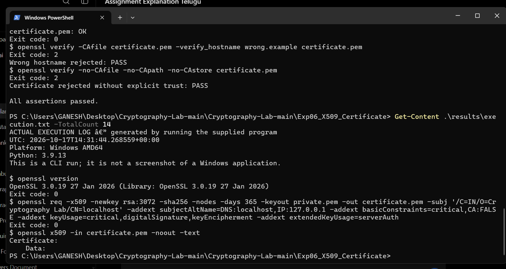
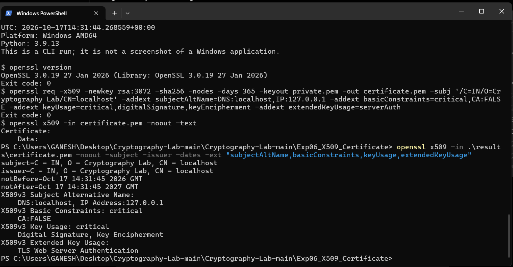
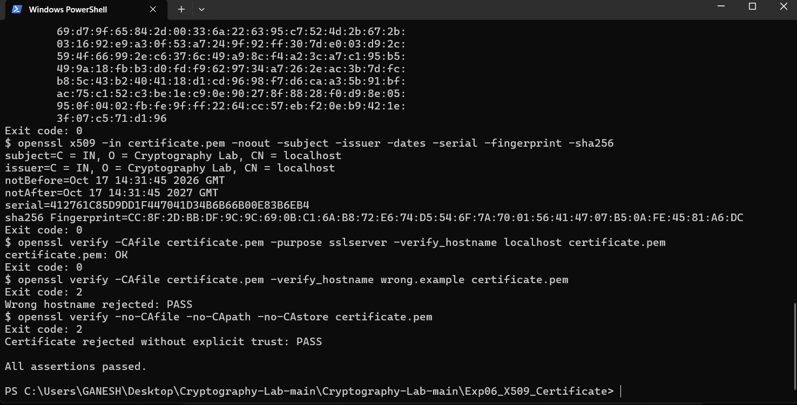
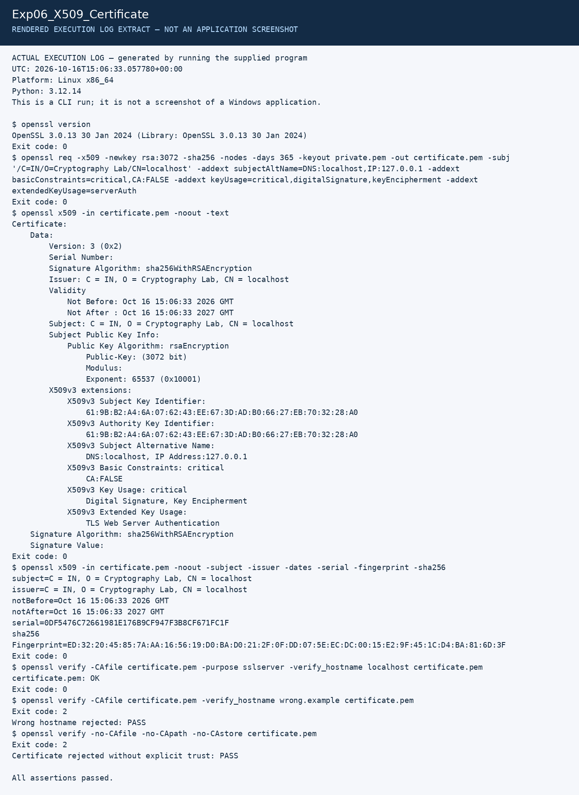

# Experiment 6: Self-Signed X.509 Certificate

| Detail | Information |
|---|---|
| Student | k vijay krishna prasad |
| Course | Cryptography — CSL0509 |
| Programme | B.Tech AIML, V Semester |
| Faculty | Mr. Hirendra Singh Sengar |
| Academic year | 2026–27 |

**Evidence status:** The student generated, inspected and verified a self-signed certificate in Windows PowerShell on 17 October 2026. Three original screenshots record generation, attributes and trust/hostname tests. All assertions passed.

## Aim

Create a self-signed X.509 certificate and analyze identity, public key, validity, extensions and trust.

## Run and procedure

```powershell
openssl version
python Exp06_X509_Certificate/run.py
```

The script generates an RSA-3072 key and a certificate signed with SHA-256, requests 365 days of validity, then inspects it with `openssl x509`. It verifies the certificate with an explicitly trusted copy, checks the correct hostname, and tests rejection of both a wrong hostname and an untrusted self-signed certificate.

## Attributes

| Attribute | Meaning / configured value |
|---|---|
| Subject | `C=IN, O=Cryptography Lab, CN=localhost` |
| Issuer | Same as subject: the certificate is self-signed |
| SAN | DNS `localhost`, IP `127.0.0.1` |
| Public key | RSA, 3072 bits |
| Signature | SHA-256 with RSA |
| Basic constraints | CA:FALSE; this is a leaf certificate |
| Key usage | Digital signature and key encipherment |
| Extended key usage | Server authentication |
| Validity | Concrete notBefore/notAfter dates appear in the saved output |
| Serial and fingerprint | Identify this generated certificate; regenerated certificates differ |

The earlier Linux run’s [certificate_details.txt](results/certificate_details.txt) and public [certificate.pem](results/certificate.pem) remain available. The Windows run generated a different certificate, evidenced by the screenshots below; its certificate file has not been supplied. Private keys are not retained by the runner.

## Result and interpretation

Explicit-trust verification for `localhost` passed. A different hostname failed. Verification with no trusted CA source failed for the self-signed certificate. Its signature protects the certificate contents, but self-signing does not establish third-party identity trust. Valid dates and an intact signature alone are insufficient for public trust.

## Student Windows execution

Environment: Windows AMD64, Python 3.9.13 and OpenSSL 3.0.19 (27 January 2026). The generation screenshot shows the saved run log, including the RSA-3072/SHA-256 generation command and exit code 0. The attributes screenshot shows a direct inspection of the saved Windows certificate.

| Observed attribute or check | Windows result |
|---|---|
| Subject and issuer | `C=IN, O=Cryptography Lab, CN=localhost` |
| Valid from | 17 October 2026, 14:31:45 GMT |
| Valid until | 17 October 2027, 14:31:45 GMT |
| SAN | `DNS:localhost`, `IP Address:127.0.0.1` |
| Basic constraints | Critical; `CA:FALSE` |
| Key usage | Critical; Digital Signature, Key Encipherment |
| Extended key usage | TLS Web Server Authentication |
| Explicit trust and correct hostname | `certificate.pem: OK`, exit code 0 |
| Wrong hostname | Rejected, expected exit code 2; PASS |
| No explicit trust | Rejected, expected exit code 2; PASS |
| Overall run | `All assertions passed.` |

The exit code 2 entries are expected negative tests, not a failed experiment. The date range is the certificate’s validity period, not evidence of public trust.

- [x] OpenSSL version and certificate generation command
- [x] Subject, issuer, validity, SAN and extensions
- [x] Trusted verification and rejection checks

### Generation



### Certificate attributes



### Verification



The generic CLI-run notice in the text log describes the program output; these images are actual student-supplied Windows PowerShell screenshots.

## Earlier Linux execution artifacts

These files belong to the earlier Linux preparation run. They must not be interpreted as the certificate or log from the separate Windows run above.

[Full execution log](results/execution.txt) · [Machine-readable results](results/summary.json)

The image below is a **rendered extract of the actual execution log**, not a screenshot of CrypTool, VS Code, Kali or Wireshark.



## References

- [OpenSSL x509](https://docs.openssl.org/3.0/man1/openssl-x509/)
- [OpenSSL verify](https://docs.openssl.org/3.0/man1/openssl-verify/)
