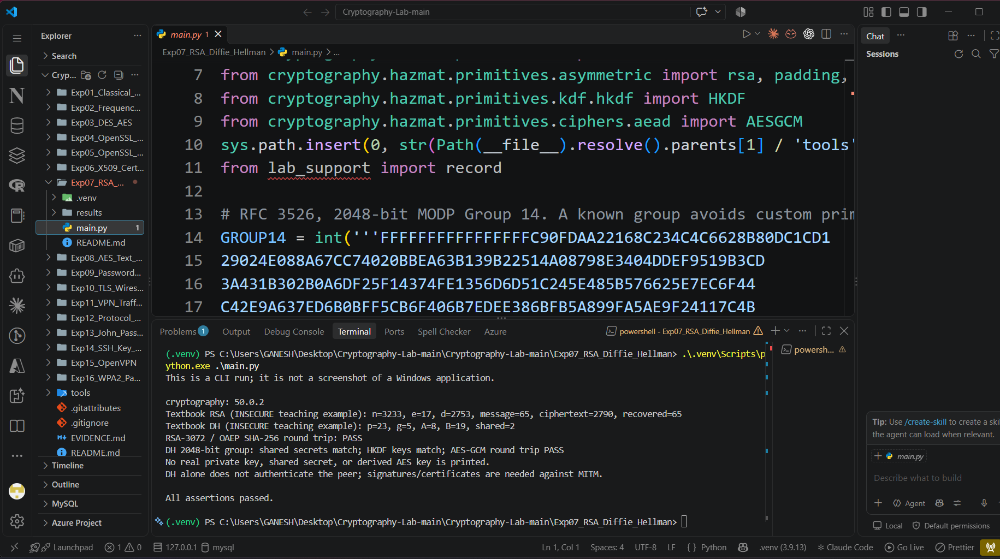
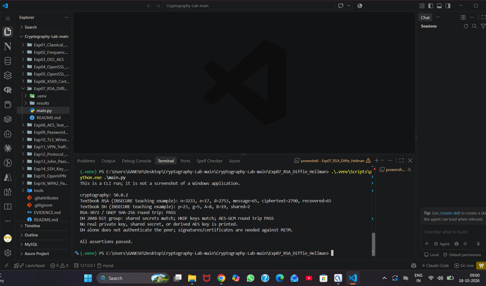

# Experiment 7: RSA and Diffie–Hellman in Python

| Detail | Information |
|---|---|
| Student | k vijay krishna prasad |
| Course | Cryptography — CSL0509 |
| Programme | B.Tech AIML, V Semester |
| Faculty | Mr. Hirendra Singh Sengar |
| Academic year | 2026–27 |

**Evidence status:** Executed in Linux CLI, then successfully run by the student in the required VS Code environment on Windows on 18 October 2026. Two original screenshots record code, the Python 3.9.13 virtual environment, cryptography 50.0.2 and all checks passing.

## Aim

Implement RSA arithmetic and Diffie–Hellman key exchange, then demonstrate library-based RSA-OAEP and finite-field DH with a derived AES key.

## Setup and run in VS Code

Open the repository folder. With the integrated terminal located at the repository root:

```powershell
python -m venv .venv
.venv\Scripts\python.exe -m pip install -r requirements.txt
.venv\Scripts\python.exe Exp07_RSA_Diffie_Hellman/main.py
```

Select `.venv` as the Python interpreter if VS Code asks. On Linux use `.venv/bin/python` instead.

If the terminal is already inside `Exp07_RSA_Diffie_Hellman` and `.venv` was created there, use these paths instead:

```powershell
.\.venv\Scripts\python.exe -m pip install -r ..\requirements.txt
.\.venv\Scripts\python.exe .\main.py
```

This is the layout used for the student’s successful Windows run. The requirements file is in the parent repository folder.

## Algorithms

**RSA teaching example:** choose p=61 and q=53; calculate n=3233 and φ(n)=3120. Choose e=17 and find d=2753. Encrypt m=65 as `c = m^e mod n = 2790`; decrypt with `m = c^d mod n = 65`. These tiny parameters and raw RSA are insecure teaching examples only.

**DH teaching example:** p=23, g=5, Alice's a=6 and Bob's b=15 give public values A=8, B=19. Both compute shared value 2 using modular exponentiation. The code then uses a known 2048-bit MODP group, random private keys and HKDF-SHA256 for the library demonstration.

## Procedure and results

1. Run both toy examples and check the arithmetic.
2. Generate RSA-3072 and encrypt/decrypt bytes with OAEP/SHA-256; exact comparison passes.
3. Generate independent DH keys for Alice and Bob in RFC 3526 Group 14.
4. Exchange public keys and calculate each shared secret independently.
5. Derive matching 32-byte AES keys with HKDF and the same salt/context.
6. Encrypt using Alice's derived key and decrypt with Bob's key using AES-GCM; the round trip passes.

The earlier Linux preparation run emitted a warning that finite-field DH is deprecated; this experiment retains it to illustrate the assigned algorithm. Modern applications generally use a modern authenticated key-exchange protocol. The actual secret values are not logged.

## Limitation

Equal DH secrets demonstrate agreement, not peer identity. Without authenticated public keys, DH is vulnerable to a man-in-the-middle attack. This standalone demonstration is not a production secure channel.

## Student VS Code execution

Both original screenshots were supplied on 18 October 2026. They show the VS Code integrated PowerShell terminal, an experiment-local `.venv`, cryptography 50.0.2, and `All assertions passed.` The code screenshot also shows the `.venv (3.9.13)` interpreter in the status bar.

| Observed check | Result |
|---|---|
| Textbook RSA | n=3233, e=17, d=2753, message=65, ciphertext=2790, recovered=65 |
| Textbook DH | p=23, g=5, A=8, B=19, shared=2 |
| RSA-3072 / OAEP SHA-256 round trip | PASS |
| DH 2048-bit shared secrets | Match |
| HKDF-derived keys | Match |
| AES-GCM round trip with derived keys | PASS |
| Overall run | All assertions passed |

The tiny textbook values are teaching inputs. Real private keys, DH shared secrets and derived AES keys are not displayed. Peer authentication is not implemented by this standalone example.

- [x] VS Code source code, selected interpreter and runtime dependency version captured
- [x] Toy arithmetic and library RSA/DH/HKDF/AES-GCM results captured





The generic CLI-run notice in the text output describes the program log; these images are original screenshots of the actual VS Code window.

## Earlier Linux execution artifacts

The files below remain from the earlier Linux preparation run. The student’s Windows output is separately evidenced by the screenshots above; the Windows-generated log and JSON have not been supplied.

[Full execution log](results/execution.txt) · [Machine-readable results](results/summary.json)

The image below is a **rendered extract of the actual execution log**, not a screenshot of CrypTool, VS Code, Kali or Wireshark.


## References

- [RFC 3526 groups](https://www.rfc-editor.org/rfc/rfc3526)
- [cryptography DH](https://cryptography.io/en/stable/hazmat/primitives/asymmetric/dh/)
