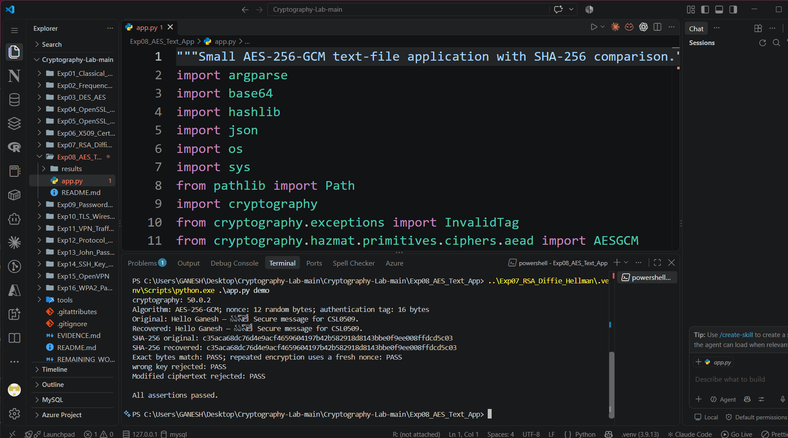

# Experiment 8: AES Text Encryption and SHA-256

| Detail | Information |
|---|---|
| Student | k vijay krishna prasad |
| Course | Cryptography — CSL0509 |
| Programme | B.Tech AIML, V Semester |
| Faculty | Mr. Hirendra Singh Sengar |
| Academic year | 2026–27 |

**Evidence status:** Application and positive/negative tests executed in Linux CLI, then the student successfully ran the demo in Windows VS Code on 18 October 2026. An original screenshot records code, interpreter, matching hashes and rejection checks; all assertions passed.

## Aim and design

Secure UTF-8 text with AES-256-GCM and compare original/recovered SHA-256 digests. The ciphertext envelope stores a random 12-byte nonce and ciphertext with its 16-byte authentication tag. The key is kept separately. A fixed format label is authenticated as associated data.

## Run the demonstration

After installing `requirements.txt`, run from the repository root in VS Code:

```powershell
python Exp08_AES_Text_App/app.py demo
```

For the student’s experiment-local environment, run the following from inside `Exp08_AES_Text_App`:

```powershell
..\Exp07_RSA_Diffie_Hellman\.venv\Scripts\python.exe .\app.py demo
```

This reuses the environment already installed for Experiment 7.

## Use the application with your own lab text

Create a private local directory and an input text file, then run:

```powershell
mkdir .private
python Exp08_AES_Text_App/app.py keygen --key .private/aes.key
python Exp08_AES_Text_App/app.py encrypt --key .private/aes.key --input message.txt --output .private/message.enc.json
python Exp08_AES_Text_App/app.py decrypt --key .private/aes.key --input .private/message.enc.json --output .private/recovered.txt
```

Use a new output filename if one already exists. The application refuses to overwrite existing output/key files. Keep the `.private` directory local; never upload its AES key. The demo uses a temporary in-memory key and cannot decrypt its saved envelope in a later process; the commands above retain a local key for that purpose.

## Algorithm and verification

1. Read text bytes and calculate SHA-256.
2. Generate a fresh nonce for encryption under the AES key.
3. Encrypt and authenticate the bytes using AES-GCM.
4. Decode and validate the envelope when decrypting.
5. Verify the authentication tag before returning plaintext.
6. Compare recovered bytes and hashes with the original.

The demo passed Unicode and empty-message round trips, verified a fresh nonce on a repeated encryption, and rejected a wrong key and a modified ciphertext. The full output and digest are in `results`. SHA-256 is a comparison aid; GCM's keyed tag provides message authentication. Never intentionally reuse a nonce with the same GCM key.

## Student Windows VS Code demonstration

The original screenshot shows `app.py`, the selected `.venv (3.9.13)` interpreter, cryptography 50.0.2, and the demo executed through the Experiment 7 virtual environment. It contains all three requested screenshot categories in one capture.

| Observed check | Result |
|---|---|
| Algorithm | AES-256-GCM; 12-byte random nonce; 16-byte tag |
| Original and recovered message | Same displayed text; exact bytes match PASS |
| Original and recovered SHA-256 | Equal |
| Repeated encryption | Fresh nonce check PASS |
| Wrong key | Rejected; PASS |
| Modified ciphertext | Rejected; PASS |
| Overall demo | All assertions passed |

The shared SHA-256 digest displayed in this run is:

```text
c35aca68dc76d4e9acf4659604197b42b582918d8143bbe0f9ee008ffdcd5c03
```

- [x] Application code and Python interpreter captured
- [x] Original/recovered messages and matching hashes captured
- [x] Wrong-key and modified-ciphertext rejection captured



This screenshot records the `demo` command. Separate file-based `keygen`, `encrypt` and `decrypt` commands were tested in the earlier Linux preparation environment; they are not shown as Windows executions here.

## Earlier Linux execution artifacts

The files below remain from the earlier Linux preparation run. The Windows run used a fresh temporary key and ciphertext; its generated results files have not been supplied. Its actual VS Code screenshot is recorded separately above.

[Full execution log](results/execution.txt) · [Machine-readable results](results/summary.json)

The image below is a **rendered extract of the actual execution log**, not a screenshot of CrypTool, VS Code, Kali or Wireshark.


## References

- [cryptography authenticated encryption](https://cryptography.io/en/stable/hazmat/primitives/aead/)
