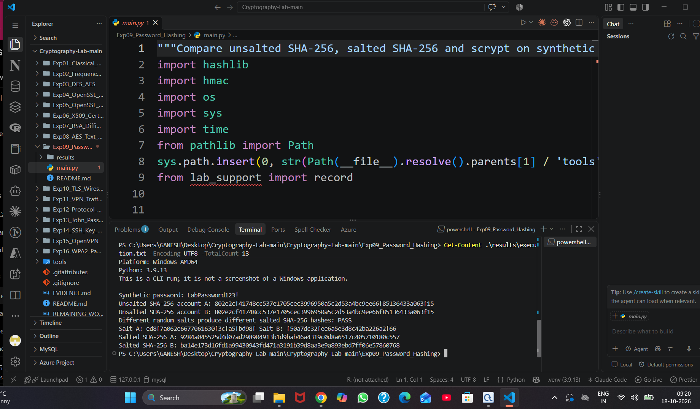
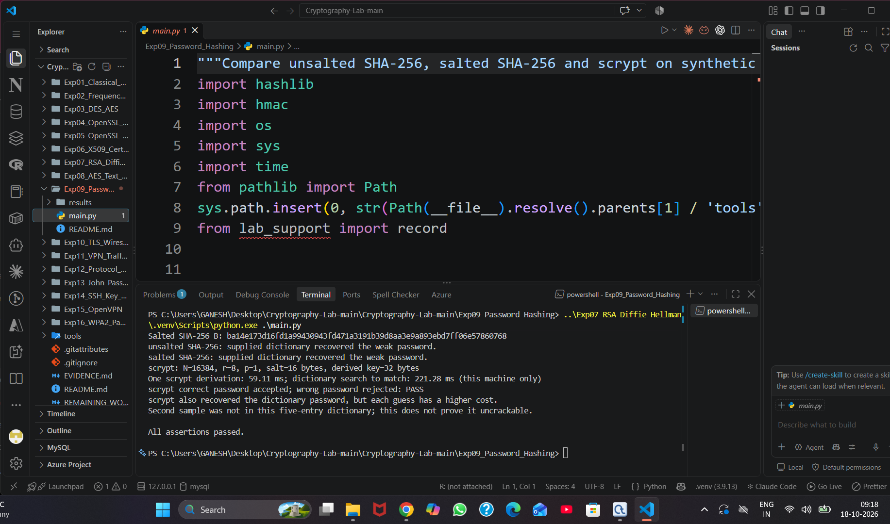
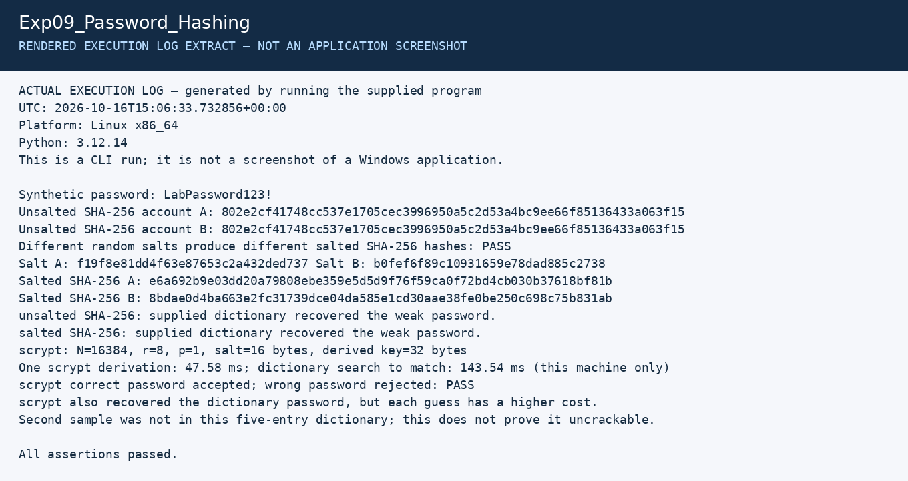

# Experiment 9: Password Hashing and Salting

| Detail | Information |
|---|---|
| Student | k vijay krishna prasad |
| Course | Cryptography — CSL0509 |
| Programme | B.Tech AIML, V Semester |
| Faculty | Mr. Hirendra Singh Sengar |
| Academic year | 2026–27 |

**Evidence status:** Executed in Linux, then successfully run by the student in Windows VS Code on 18 October 2026. Two original screenshots record source/interpreter, unsalted and salted hashes, dictionary comparisons and scrypt checks; all assertions passed.

## Aim

Compare unsalted SHA-256, salted SHA-256 and a password-specific derivation function, scrypt, using synthetic passwords.

## Run

```powershell
python Exp09_Password_Hashing/main.py
```

This experiment only needs Python's standard library. Run it in VS Code for the assignment's environment evidence. The student reused the Experiment 7 environment; from inside `Exp09_Password_Hashing`, the command is:

```powershell
..\Exp07_RSA_Diffie_Hellman\.venv\Scripts\python.exe .\main.py
```

## Procedure and algorithm

1. Hash the same sample password for two accounts with SHA-256; the hashes match.
2. Generate two independent 16-byte random salts and hash `salt || password`; the hashes differ.
3. Try a five-entry synthetic dictionary against both hash methods. The correct weak password is recovered in both cases because the salt is public and does not stop guessing.
4. Derive a 32-byte scrypt hash with N=16384, r=8, p=1. Store the parameters and salt with the hash in a real application.
5. Verify the correct password using a constant-time comparison and reject a wrong password.
6. Repeat the small dictionary experiment with scrypt, and measure the local time.

## Observations

- Unsalted equality leaks password reuse and permits reuse of precomputed guesses.
- Unique salts prevent identical passwords from yielding identical stored values and require per-salt work.
- Fast salted SHA-256 is still unsuitable as a password storage design.
- Scrypt makes guesses costlier through CPU and memory work, but a weak password in the dictionary was still found.
- A second synthetic sample was not in the five-entry dictionary. That result does not measure its overall strength or prove resistance to larger attacks.

Timing values in `summary.json` are local observations, not universal cracking-time estimates. The selected scrypt cost is a lab parameter; production systems must choose and benchmark a current password-storage policy.

## Student Windows VS Code execution

Two original screenshots dated 18 October 2026 show the source, selected Python 3.9.13 virtual environment and Windows AMD64 output. The salt-comparison image displays the saved run log using `Get-Content`; the other image records the completed program output. Together they cover the three required evidence categories.

| Observed check | Windows result |
|---|---|
| Same synthetic password, unsalted SHA-256 | Account A and B hashes identical |
| Independent random salts | Distinct salts and distinct salted hashes; PASS |
| Five-entry supplied dictionary | Weak sample recovered with unsalted SHA-256, salted SHA-256 and scrypt |
| scrypt settings | N=16384, r=8, p=1; 16-byte salt; 32-byte derived key |
| One scrypt derivation | 59.11 ms |
| Dictionary search until match | 141.28 ms |
| Correct/wrong password checks | Correct accepted, wrong rejected; PASS |
| Second synthetic sample | Not found in this five-entry dictionary |
| Overall run | All assertions passed |

The timing numbers are single-run observations from this Windows execution, not benchmark medians or universal password-cracking estimates. The second sample's absence from a five-entry dictionary does not prove it uncrackable. Salting changes the hashes but does not prevent guessing a weak password that is in the dictionary.

- [x] VS Code source and Python interpreter captured
- [x] Equal unsalted hashes and distinct salted hashes captured
- [x] Dictionary results, scrypt timing and password verification captured





The generic CLI-run notice describes the program text log; these images are actual student-supplied VS Code screenshots. All passwords shown are synthetic lab examples.

## Earlier Linux execution artifacts

These files remain from the earlier Linux preparation run. Their random salts and timing values differ from the separate Windows run above. Windows-generated log and JSON files have not been supplied; its screenshots are recorded above.

[Full execution log](results/execution.txt) · [Machine-readable results](results/summary.json)

The image below is a **rendered extract of the actual execution log**, not a screenshot of CrypTool, VS Code, Kali or Wireshark.



## References

- [Python hashlib key derivation](https://docs.python.org/3/library/hashlib.html#key-derivation)
- [scrypt specification](https://www.rfc-editor.org/rfc/rfc7914)
