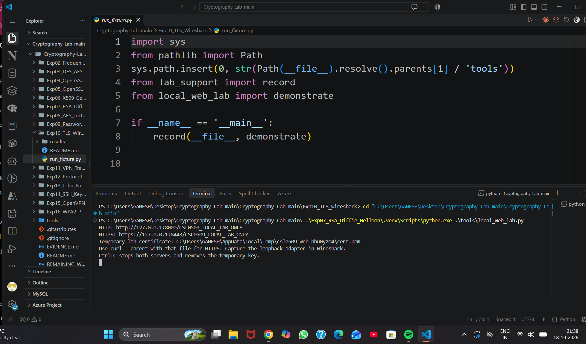
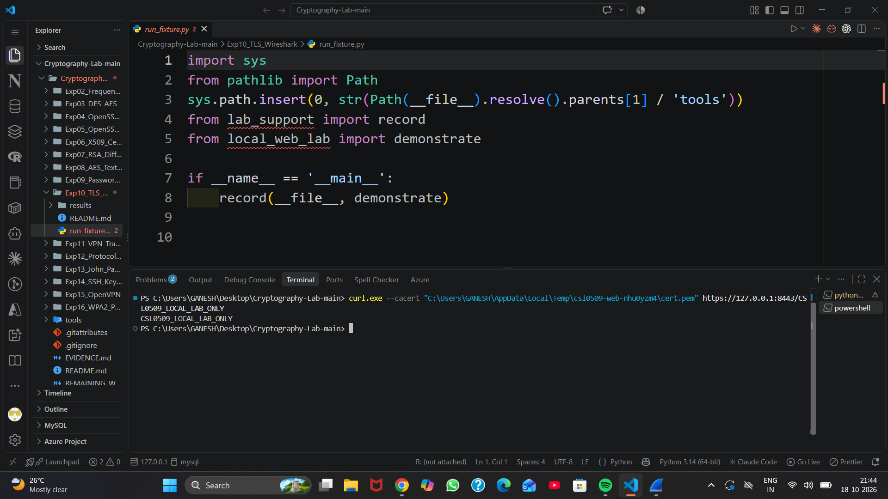
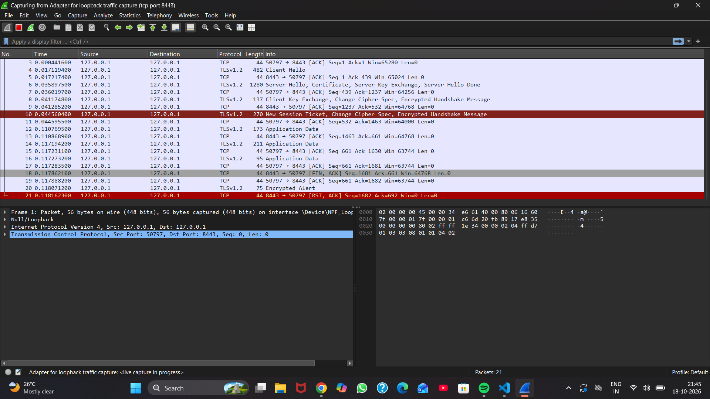
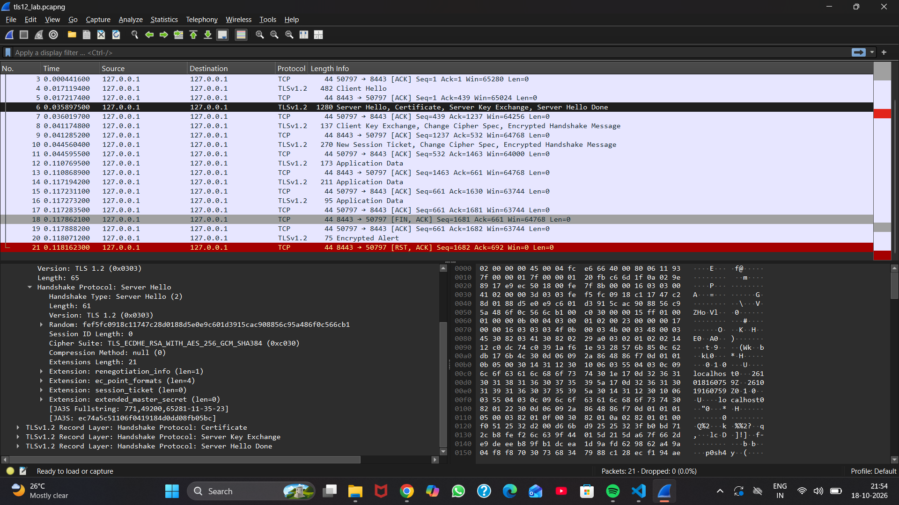
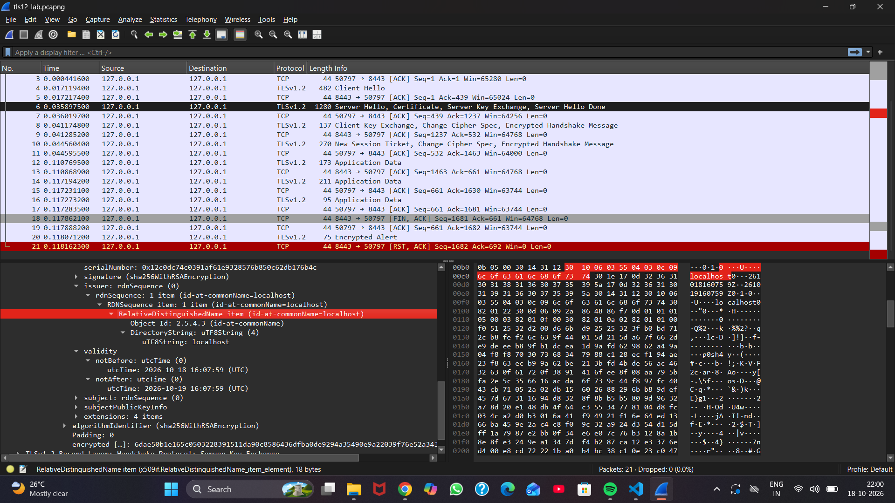
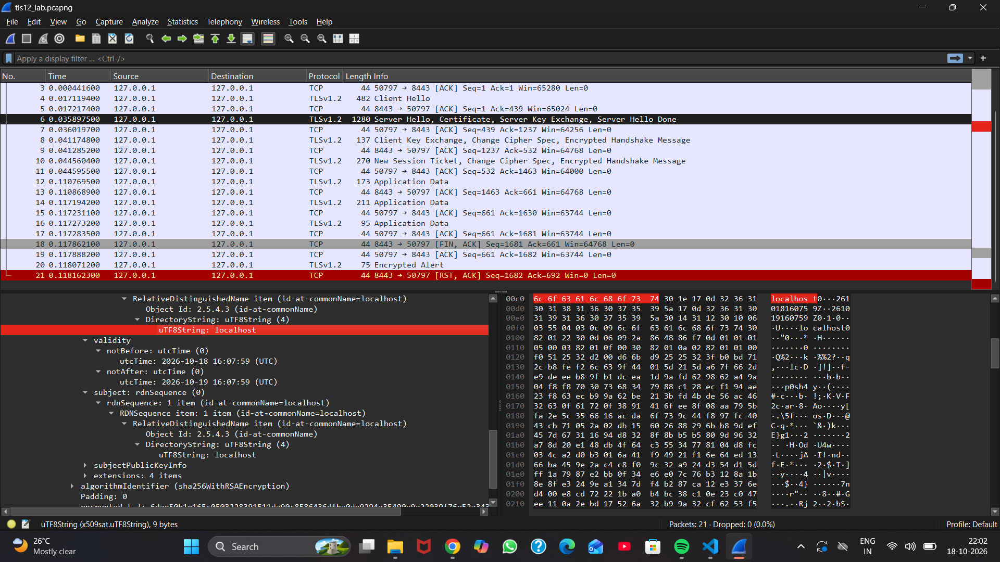
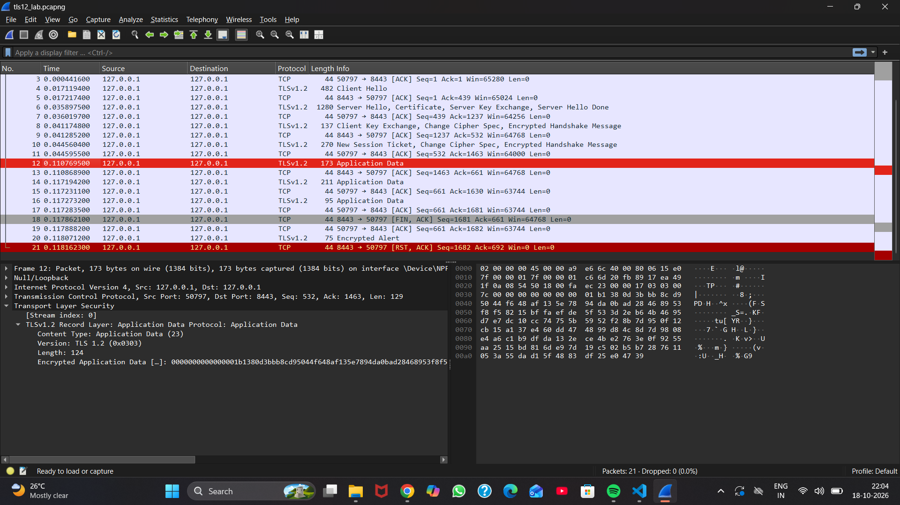

# Experiment 10: HTTPS and TLS Analysis

**k vijay krishna prasad · Cryptography CSL0509 · B.Tech AIML, V Semester · 2026–27**  
Faculty: Mr. Hirendra Singh Sengar

**Status: Windows TLS 1.2 capture and analysis completed on 18 October 2026.** The original capture and seven original screenshots are included. The earlier Linux fixture exercised TLS 1.3, but no Windows TLS 1.3 capture is claimed.

## Aim

Capture HTTPS traffic in Wireshark and identify the TLS handshake, selected cipher suite, certificate and encrypted application data.

## Setup and procedure

The student used Windows, Wireshark 4.6.9 (reviewed in the setup screenshot), Npcap loopback capture, a Python HTTPS fixture and curl.exe. The server command explicitly uses the existing Experiment 7 virtual environment; VS Code's editor interpreter selection does not identify the interpreter used by that command.

1. From the repository root start the fixture and keep its terminal open:

   ```powershell
   .\Exp07_RSA_Diffie_Hellman\.venv\Scripts\python.exe .\tools\local_web_lab.py
   ```

2. The fixture prints HTTP port 8000, HTTPS port 8443 and its temporary certificate path. HTTPS defaults to TLS 1.2.
3. Select **Adapter for loopback traffic capture** in Wireshark, set capture filter `tcp port 8443`, and start capture.
4. In another PowerShell terminal, substitute the actual printed certificate path:

   ```powershell
   curl.exe --cacert "C:\actual\temporary\cert.pem" https://127.0.0.1:8443/CSL0509_LOCAL_LAB_ONLY
   ```

5. Confirm response `CSL0509_LOCAL_LAB_ONLY`, stop capture and save `tls12_lab.pcapng`.
6. Inspect packet 4, packet 6 and application-data packets 12, 14 and 16.
7. After local capture work is finished, Ctrl+C stops the fixture and removes its temporary private key.

The self-signed certificate is explicitly trusted by this client command; it is not a publicly trusted certificate. A fresh fixture run generates a different certificate and temporary path.

## Verified observations

[Original packet capture](tls12_lab.pcapng)

| Item | Observed value |
|---|---|
| Capture | 21 packets; Wireshark reports 0 dropped |
| Endpoints | Client `127.0.0.1:50797`, server `127.0.0.1:8443` |
| Negotiated protocol | TLS 1.2 (`0x0303` in Server Hello) |
| Selected cipher suite | `TLS_ECDHE_RSA_WITH_AES_256_GCM_SHA384` (`0xc030`) |
| Certificate subject / issuer | Both `CN=localhost` |
| Subject alternative names | `DNS:localhost`, `IP:127.0.0.1` (decoded from capture) |
| Valid from | 2026-10-18 16:07:59 UTC |
| Valid until | 2026-10-19 16:07:59 UTC |
| Certificate signature | SHA-256 with RSA |
| Client response | `CSL0509_LOCAL_LAB_ONLY` |
| Payload visibility | Application records encrypted; the marker is absent as plaintext in the supplied capture |

The one-day certificate was valid during this run. Later expiration does not invalidate the recorded observation.

| Packet | Observation |
|---:|---|
| 4 | Client Hello begins negotiation. Offered suites are proposals; the selected suite is read from Server Hello. |
| 6 | Server Hello, Certificate, Server Key Exchange and Server Hello Done. Initial TLS 1.2 certificate is visible without session secrets. |
| 8 | Client Key Exchange, Change Cipher Spec and encrypted handshake record. |
| 10 | New Session Ticket, Change Cipher Spec and encrypted handshake record. |
| 12 | Client encrypted Application Data, TLS record body 124 bytes. |
| 14, 16 | Server encrypted Application Data, record bodies 162 and 46 bytes. |
| 18–21 | Teardown includes FIN, encrypted alert and final RST/ACK. Client screenshot separately records successful response receipt. |

ECDHE provides ephemeral key agreement, RSA authenticates the server handshake, and AES-256-GCM protects application records. SHA-384 is the suite's TLS PRF hash; the certificate's SHA-256 signature is separate. Endpoints, timing, record sizes and the initial TLS 1.2 certificate remain visible. No session secrets were supplied and no application payload was decrypted. Absence of a plaintext marker alone is not a general cryptographic security proof.

## Display filters

| Filter | Purpose |
|---|---|
| `tcp.port == 8443` | Local test connection |
| `tls.handshake.type == 1` | Client Hello |
| `tls.handshake.type == 2` | Server Hello |
| `tls.handshake.type == 11` | Visible Certificate message |
| `tls.record.content_type == 23` | Application-data records in this TLS 1.2 capture |

## Original screenshots

### Local server and successful client response





### Loopback capture and selected cipher





### Certificate identity and validity





### Encrypted application data



## Result and provenance

The student captured a successful local HTTPS exchange and identified TLS 1.2, the selected cipher, certificate identity/validity and encrypted application records. The supplied PCAPNG was independently parsed offline, and its certificate was decoded with OpenSSL. The original capture and screenshots are copied without modification.

Capture SHA-256: `9b30f533a8ddacce3febae3f76a3ec2fb1aeca4dc7949e1f871b5f9ad21738f1`.

The earlier Linux fixture [execution log](results/execution.txt) and [JSON results](results/summary.json) remain supplementary application-level evidence, separate from this Windows capture. Their rendered log image is not a Wireshark screenshot. This capture does not complete the separate HTTP/HTTPS comparison or VPN experiments.

## References

- [Wireshark TLS](https://wiki.wireshark.org/TLS)
- [Loopback capture](https://wiki.wireshark.org/CaptureSetup/Loopback)
- [TLS display filters](https://www.wireshark.org/docs/dfref/t/tls.html)

