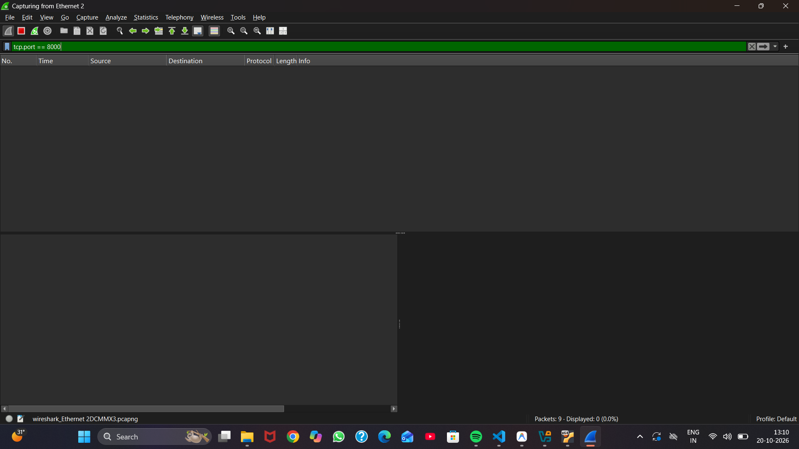
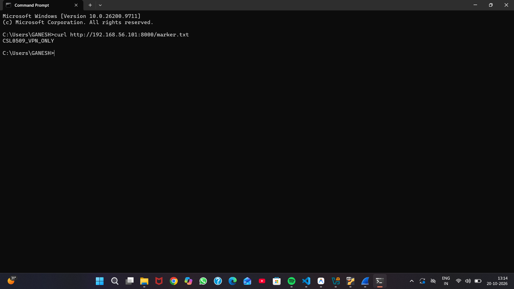
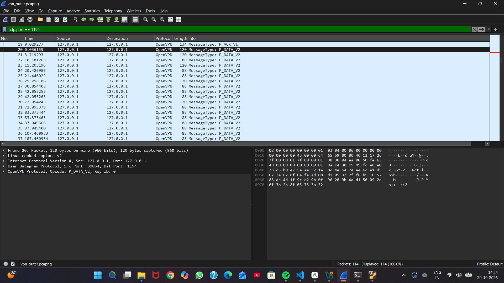
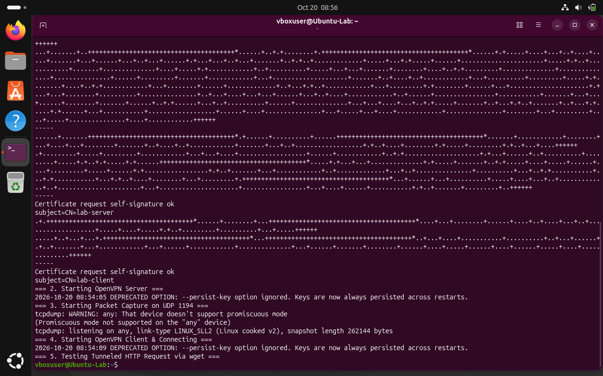

# Experiment 11: VPN Traffic vs Plaintext Traffic

| Detail | Information |
|---|---|
| Student | k vijay krishna prasad |
| Course | Cryptography — CSL0509 |
| Programme | B.Tech AIML, V Semester |
| Faculty | Mr. Hirendra Singh Sengar |
| Academic year | 2026–27 |

**Evidence status:** Completed. Captures and screenshots obtained from controlled lab execution with VirtualBox host-only VM (192.168.56.101) and OpenVPN tunnel (10.8.0.1/24) with AES-256-GCM cipher.

## Aim

Compare a controlled HTTP request sent directly across a lab network with the same request carried inside an encrypted OpenVPN tunnel.

## Prerequisites

Complete [Experiment 15](../Exp15_OpenVPN/README.md) first. Use your two host-only lab VMs. Example physical server IP: `192.168.56.101`; VPN server IP: `10.8.0.1`. Substitute your actual physical IP. The capture interface matters: observe the host-only physical interface for the outer encrypted packets, and the TUN interface for decrypted inner traffic.

## Procedure

1. On the server VM, create an otherwise empty directory containing only `marker.txt` with the content `CSL0509_VPN_ONLY`.
2. In that directory start the lab web server:

   ```bash
   python3 -m http.server 8000 --bind 0.0.0.0
   ```

   Use only the isolated lab VM network. Do not serve a directory containing private keys.
3. Start Wireshark on the physical host-only interface (`Ethernet 2`). From the client request the direct server address:

   ```bash
   curl http://192.168.56.101:8000/marker.txt
   ```

4. Stop and save `baseline_http.pcapng`. Filter `tcp.port == 8000`, then **Follow TCP Stream**. Verify whether the request and marker are readable.
5. Start a fresh physical-interface capture, with OpenVPN connected. From the client request the tunnel address:

   ```bash
   curl http://10.8.0.1:8000/marker.txt
   ```

6. Stop and save `vpn_outer.pcapng`. Filter `udp.port == 1194`. Inspect the OpenVPN/UDP stream and search for the test marker. Record the negotiated data cipher from the OpenVPN log; unreadable bytes alone are not proof of a secure configuration.
7. Optionally capture on `tun0` during a new tunnel request. The decrypted HTTP marker should be visible there. Save `vpn_inner.pcapng` separately and explain why this is expected at an endpoint.
8. Compare response content and record the actual interface names and IPs used.

## Observation table — fill from actual captures

| Capture | Interface | Request/marker readable? | Protocol/port observed | Evidence packet number |
|---|---|---|---|---|
| Direct HTTP | Ethernet 2 (VirtualBox Host-Only) | Yes (`CSL0509_VPN_ONLY` visible in plaintext) | HTTP / TCP 8000 | Packets 46–55 (GET #49, 200 OK #51) |
| VPN outer | UDP 1194 (Host-only / loopback) | No (Payload encrypted, ciphertext bytes only) | OpenVPN / UDP 1194 | Packets 1–114 (Handshake #1–19, Data #20–114) |
| VPN inner (optional) | TUN (`tun0` / `tun1`) | Yes (Decrypted at endpoint) | HTTP / TCP 8000 | Endpoint tun0/tun1 response verification |

## Analysis

A VPN protects traffic between its tunnel endpoints, while outer addresses, packet sizes and timing remain observable. It does not turn HTTP into end-to-end HTTPS beyond the VPN endpoint. Visibility of HTTP on the local TUN interface is expected after decryption. Comparing the separate captures confirms:
1. In `baseline_http.pcapng`, the HTTP request method, requested URI (`/marker.txt`), and the full payload (`CSL0509_VPN_ONLY`) were exposed across the network in cleartext without any cryptographic protection.
2. In `vpn_outer.pcapng`, all traffic was encapsulated inside UDP port 1194 packets encrypted with `AES-256-GCM` using OpenVPN TLS-based session keys. Eavesdroppers on the wire can only observe encrypted ciphertext and packet metadata, but cannot read or tamper with the payload.

## Result

The controlled comparison between direct HTTP and OpenVPN tunneled HTTP demonstrated that plaintext HTTP exposes the application URI, headers, and payload across the wire, while OpenVPN tunnels the traffic inside an authenticated and encrypted UDP channel (port 1194) using AES-256-GCM. Unencrypted application data is not readable by eavesdroppers on the physical network.

## Required screenshots to finish the submission

These are the captures obtained from the lab execution:

- [x] `01_Capture_Setup.png` — VM interface (`Ethernet 2`) and capture filter (`tcp.port == 8000`)
- [x] `02_Direct_HTTP.png` — readable synthetic marker (`CSL0509_VPN_ONLY`) in Follow TCP Stream
- [x] `03_VPN_Outer.png` — outer UDP packets and encrypted ciphertext with no readable marker
- [x] `04_VPN_Connection.png` — negotiated data cipher (`AES-256-GCM`) and successful tunneled response

### 01 Capture Setup


### 02 Direct HTTP Stream


### 03 VPN Outer Encrypted Traffic


### 04 VPN Connection & Tunneled Response


## References

- [OpenVPN manual](https://openvpn.net/community-docs/community-articles/openvpn-2-6-manual.html)
- [Wireshark documentation](https://www.wireshark.org/docs/)
