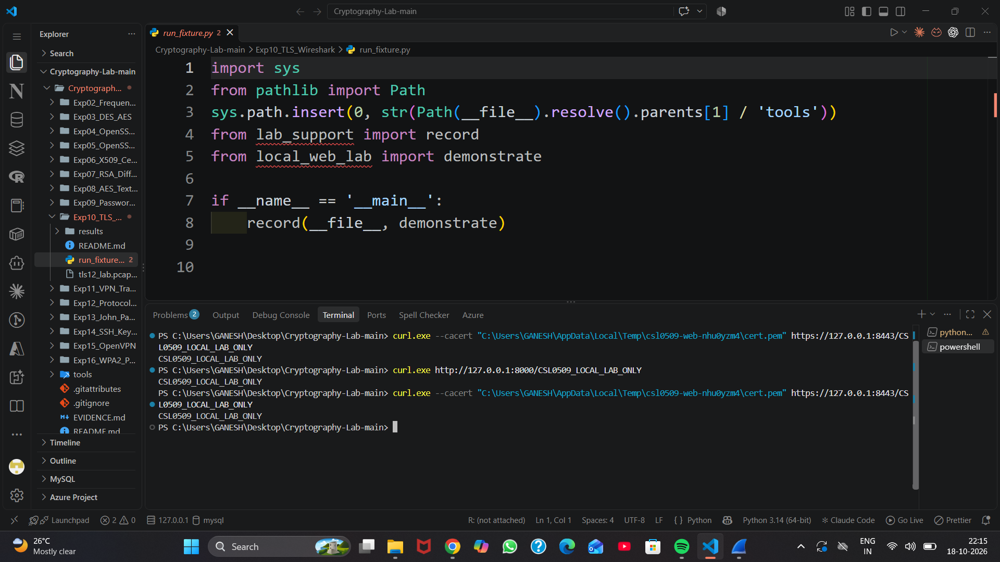
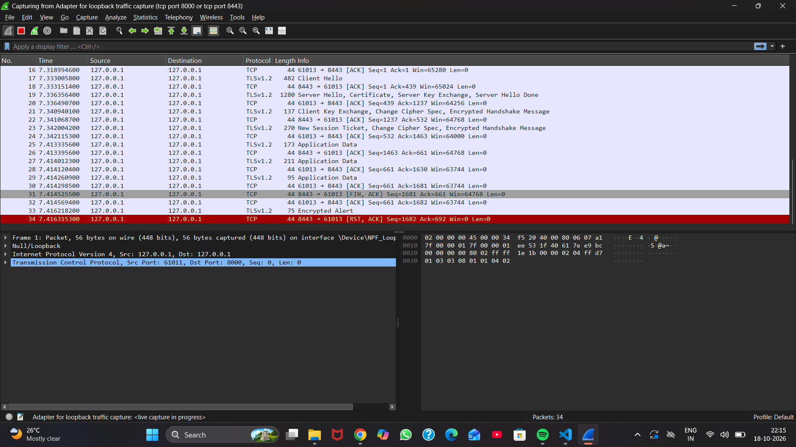
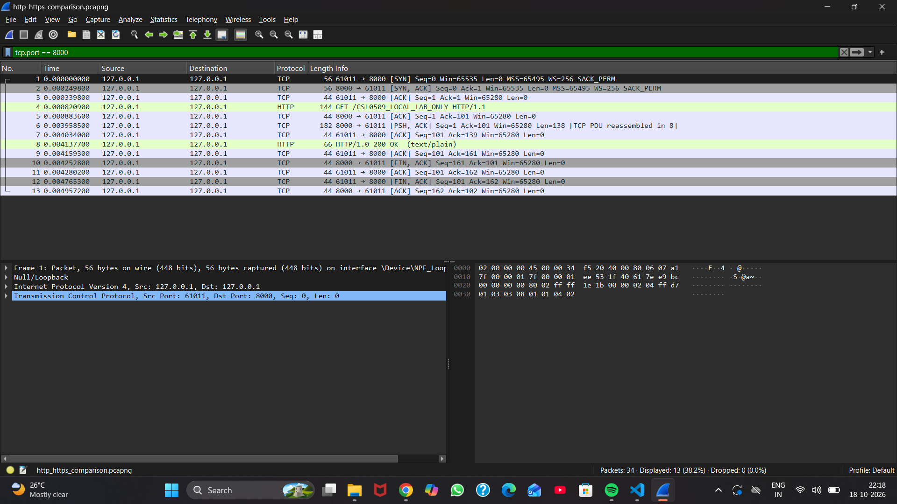
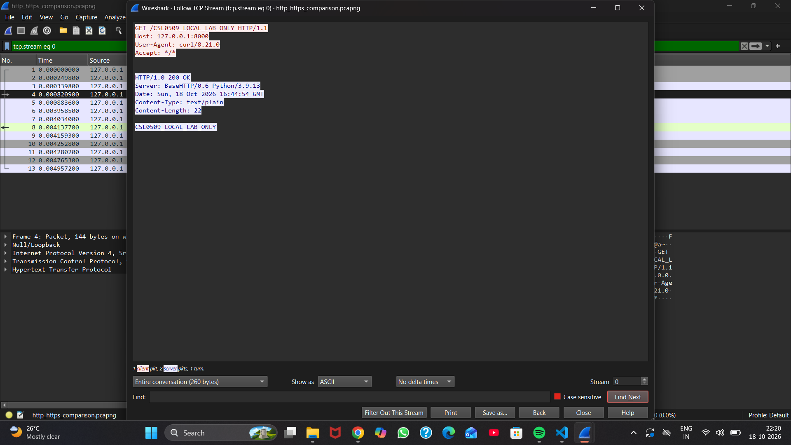
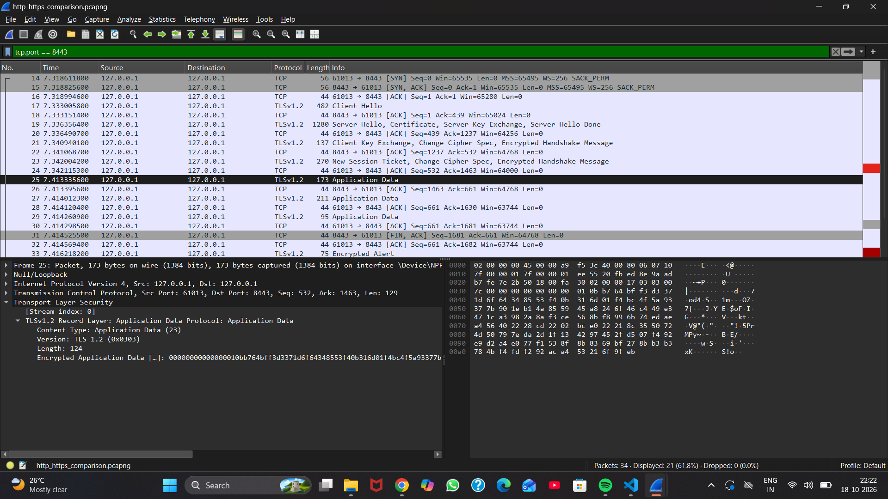
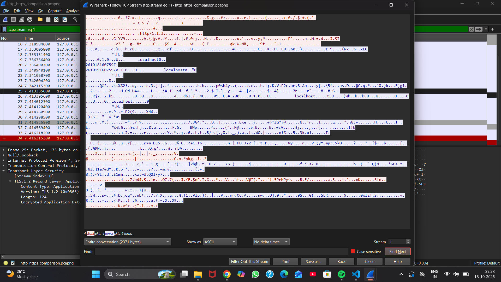

# Experiment 12: Secure and Insecure Protocols

**k vijay krishna prasad · Cryptography CSL0509 · B.Tech AIML, V Semester · 2026–27**  
Faculty: Mr. Hirendra Singh Sengar

**Status: Windows HTTP/HTTPS capture and comparison completed on 18 October 2026.** Six original student screenshots are included. The supplied 34-packet capture was analyzed; publication of the PCAPNG is awaiting explicit approval. FTP, Telnet, SSH/SFTP and DNS are discussed as theory only.

## Aim

Compare HTTP and HTTPS confidentiality, integrity protection and visible metadata using the same local test message.

## Environment and method

The student used Wireshark on Windows with Npcap loopback capture, curl 8.21.0 and the Python fixture from Experiment 10. The HTTP response identifies Python 3.9.13. Both endpoints are on the student's own computer.

1. From the repository root, start the fixture if it is not already running:

   ```powershell
   .\Exp07_RSA_Diffie_Hellman\.venv\Scripts\python.exe .\tools\local_web_lab.py
   ```

2. Keep the server terminal open. In Wireshark choose **Adapter for loopback traffic capture**, set capture filter `tcp port 8000 or tcp port 8443`, and start a fresh capture.
3. In another terminal issue both requests. Replace the certificate placeholder with the path printed by the running server:

   ```powershell
   curl.exe http://127.0.0.1:8000/CSL0509_LOCAL_LAB_ONLY
   curl.exe --cacert "C:\actual\temporary\cert.pem" https://127.0.0.1:8443/CSL0509_LOCAL_LAB_ONLY
   ```

4. Both requests return `CSL0509_LOCAL_LAB_ONLY`. Stop capture and save `http_https_comparison.pcapng`.
5. Apply display filter `tcp.port == 8000`. Right-click packet 4 and select **Follow → TCP Stream**. The GET request, response headers and message are readable.
6. Close that window and replace the display filter with `tcp.port == 8443`. Select packet 25 and expand **Transport Layer Security** to inspect encrypted Application Data. Follow its TCP stream for comparison.
7. Stop the fixture with Ctrl+C when local capture work is finished.

## Original capture and observed packets

Capture analyzed: `http_https_comparison.pcapng`. **PCAPNG publication pending:** automatic approval review requires explicit approval before publishing its packet payload and local metadata. The file is not yet included in this repository.

The file contains **34 packets: 13 for HTTP and 21 for HTTPS**. Wireshark reports **0 dropped packets**. TCP stream 0 is HTTP; TCP stream 1 is HTTPS.

| Packet(s) | Observation |
|---|---|
| 1–13 | HTTP connection: client `127.0.0.1:61011` to server `127.0.0.1:8000` |
| 4 | Plaintext `GET /CSL0509_LOCAL_LAB_ONLY HTTP/1.1`; Host and curl User-Agent readable |
| 6 | Plaintext response headers: `HTTP/1.0 200 OK`, text/plain, Content-Length 22 |
| 8 | Plaintext response body `CSL0509_LOCAL_LAB_ONLY`; Wireshark reassembles the HTTP response here |
| 14–34 | HTTPS connection: client `127.0.0.1:61013` to server `127.0.0.1:8443` |
| 17 | TLS Client Hello |
| 19 | Server Hello selects TLS 1.2 (`0x0303`) and `TLS_ECDHE_RSA_WITH_AES_256_GCM_SHA384` (`0xc030`); certificate and key exchange also present |
| 25 | Client encrypted Application Data; record body 124 bytes |
| 27, 29 | Server encrypted Application Data; record bodies 162 and 46 bytes |

The HTTP stream contains 260 TCP payload bytes across both directions; the HTTPS stream contains 2,371. These are single-exchange observations including TLS handshake data, not a general bandwidth or performance benchmark. HTTP packets occurred first; the HTTPS request was issued about 7.3 seconds later, so this gap measures user command timing rather than encryption cost.

## Comparison and interpretation

| Property | HTTP observation | HTTPS observation |
|---|---|---|
| Client output | Lab marker received | Same lab marker received |
| Request path and headers in passive capture | Readable | Protected inside TLS application records |
| Response body in passive capture | Lab marker readable | Marker absent as plaintext from the HTTPS flow |
| Transport protection | No TLS confidentiality or authentication | TLS 1.2 with AES-256-GCM; client explicitly trusts the local certificate via --cacert |
| Visible metadata | IPs, ports, sizes and timing | IPs, ports, sizes, timing and initial TLS 1.2 handshake/certificate |
| Follow TCP Stream | Readable HTTP request and response | TLS binary records with some readable handshake/certificate fields |

The HTTPS stream still contains `localhost` from the certificate and an `http/1.1` protocol label from handshake negotiation. These are expected visible TLS metadata, not exposed HTTP request/response content. The selected packet 25 explicitly decodes as **Encrypted Application Data**.

TLS provides authenticated encryption, but this exercise did not perform active tampering or a man-in-the-middle test. The marker's absence alone is not proof of general cryptographic security; it is interpreted together with the decoded TLS handshake, encrypted record type and successful certificate-validated client request. No session secrets were supplied and the HTTPS payload was not decrypted.

Port numbers alone do not prove the application protocol: this lab uses non-default HTTP/HTTPS ports and confirms protocols from decoded content and handshake messages.

## Original screenshots

### Both client requests succeed



### Capture interface and filter



### HTTP packets and readable stream





### HTTPS encrypted records and stream





## Other protocols — theory only

| Protocol | General protection or limitation |
|---|---|
| Plain FTP / Telnet | Plain variants can expose credentials and application data |
| SFTP / SSH | Encrypt application traffic; correct host-key validation matters |
| Traditional DNS over UDP/TCP | Queries are normally visible without an encrypted DNS transport |

No FTP, Telnet, SSH, SFTP or DNS traffic was captured in this experiment.

## Result and provenance

HTTP exposed the request, headers and message in the captured stream. HTTPS returned the same message to the client while protecting application content with TLS. Traffic metadata remained visible in both flows.

The six screenshots are original student uploads copied without editing. The supplied PCAPNG was analyzed without modification and is awaiting approval for publication. Capture SHA-256: `7f7852e9e80aadd9f3370994b41f9e1aa90fd99cc36addd420b2d81c51302526`. Offline parsing confirmed the packet counts, HTTP payload and selected TLS version/cipher. The earlier Linux fixture tests are supplementary; this experiment's packet evidence is the student's Windows capture.

## References

- [Wireshark TLS](https://wiki.wireshark.org/TLS)
- [Wireshark loopback capture](https://wiki.wireshark.org/CaptureSetup/Loopback)
