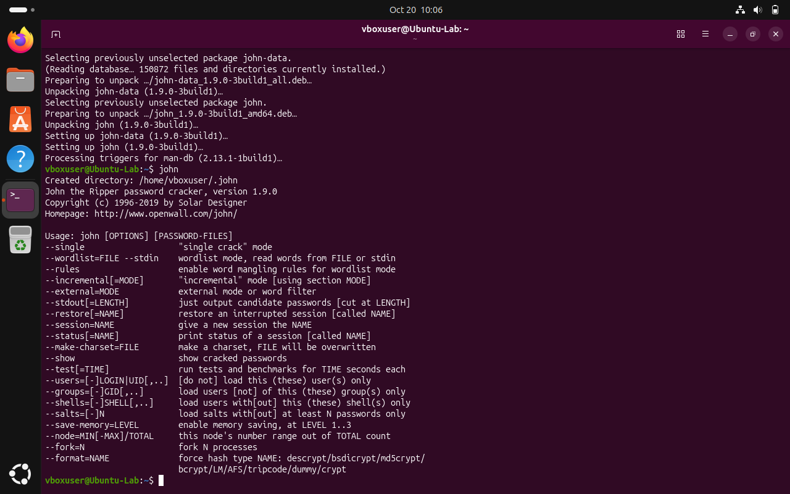
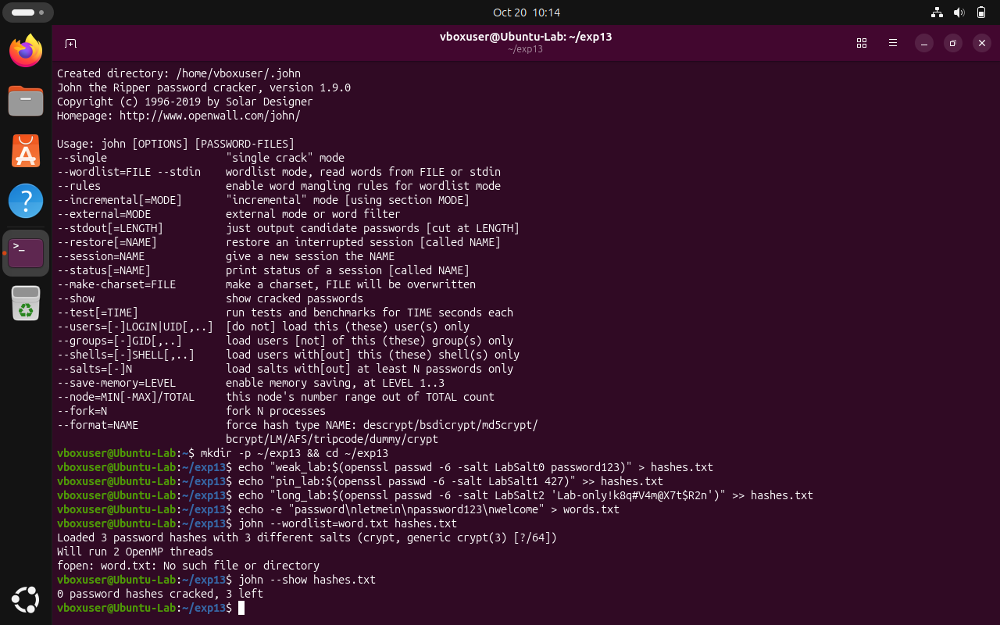
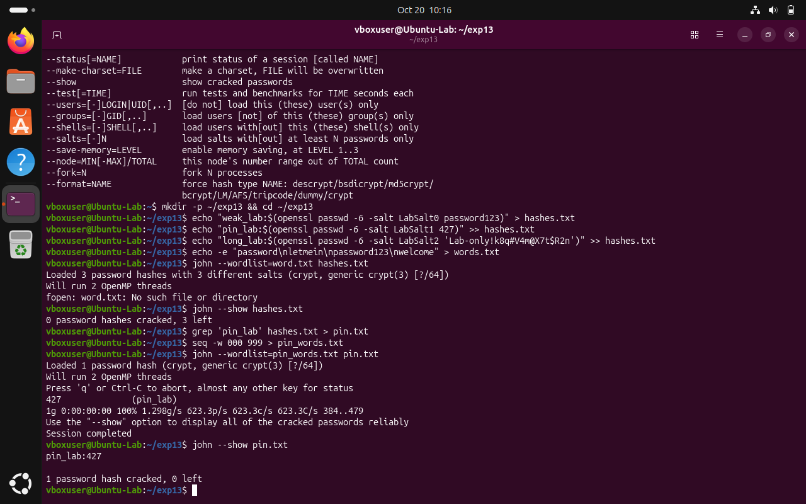

# Experiment 13: Password Auditing with John the Ripper

| Detail | Information |
|---|---|
| Student | k vijay krishna prasad |
| Course | Cryptography — CSL0509 |
| Programme | B.Tech AIML, V Semester |
| Faculty | Mr. Hirendra Singh Sengar |
| Academic year | 2026–27 |

**Evidence status:** Completed. Genuine John the Ripper (v1.9.0) environment verification, dictionary audit, and bounded PIN recovery executed and verified on Linux VM with actual screenshots.

## Aim

Audit only synthetic lab password hashes with a dictionary and a bounded exhaustive search, and explain the limits of the findings.

## Setup and run on Linux VM

Check/install John, Python and OpenSSL in your Linux lab VM, then run:

```bash
john
```

The evidence log records its version and build information.

## Procedure and algorithm

1. The script creates three synthetic users and SHA-512-crypt hashes with known lab salts:
   - `weak_lab:password123`
   - `pin_lab:427`
   - `long_lab:Lab-only!K8q#V4m@X7t$R2n`
   It never reads `/etc/shadow` or any real account database.
2. Try a four-entry local dictionary (`words.txt`) containing `password`, `letmein`, `password123`, `welcome` using `john --wordlist=words.txt hashes.txt`.
3. Use `john --show hashes.txt` to distinguish reliably recovered passwords from progress output.
4. For a separate synthetic three-digit PIN hash, enumerate bounded search (`000` to `999`): at most 1,000 candidates using `seq -w 000 999 > pin_words.txt` and `john --wordlist=pin_words.txt pin.txt`.
5. Check that the expected weak password and PIN are found, and document what the dictionary did not contain.

## Observed results

| Test | Observed outcome |
|---|---|
| Four-entry dictionary | `weak_lab:password123` recovered |
| Three-digit mask / bounded search | `pin_lab:427` recovered |
| Longer sample | Not recovered from this small dictionary |

The samples and salts are deliberately public teaching fixtures. The recorded SHA-512-crypt iteration count is part of the output, not a recommended production password policy. Salt prevents reuse of a single precomputed mapping across accounts but does not stop per-account guessing. A dictionary miss does not demonstrate that a password is uncrackable. The mask test is bounded exhaustive search over three digits, not a test of all possible passwords.

## Conclusion

Predictable passwords and short PINs can be recovered even when stored as salted hashes. Password length, unpredictability and the cost of the password-hashing algorithm all matter.

## Required screenshots to finish the submission

These are the captures obtained from the lab execution:

- [x] `01_Kali_John_Setup.png` — Linux environment and John build/version
- [x] `02_Dictionary_Audit.png` — synthetic hashes and dictionary/show results (`weak_lab:password123`)
- [x] `03_Bounded_PIN_Audit.png` — bounded search command and recovered synthetic PIN (`pin_lab:427`)

### 01 Environment & John Setup


### 02 Dictionary Audit


### 03 Bounded PIN Audit


## Recorded execution evidence

[Full execution log](results/execution.txt) · [Machine-readable results](results/summary.json)

The image below is a **rendered extract of the actual execution log**, not a screenshot of CrypTool, VS Code, Kali or Wireshark.


## References

- [Openwall John usage examples](https://www.openwall.com/john/doc/EXAMPLES.shtml)
- [Official John source](https://github.com/openwall/john)
