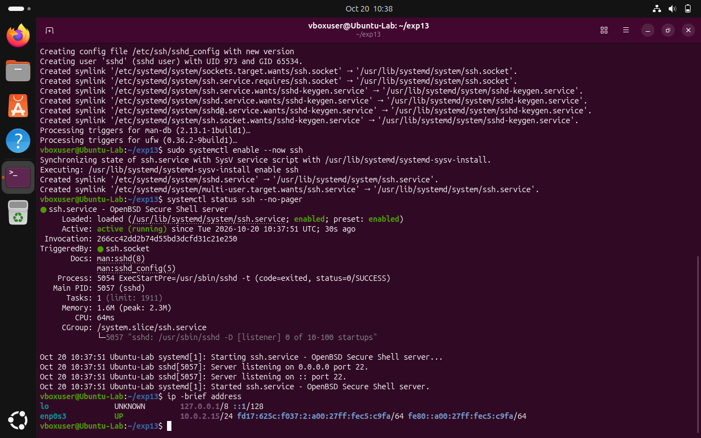
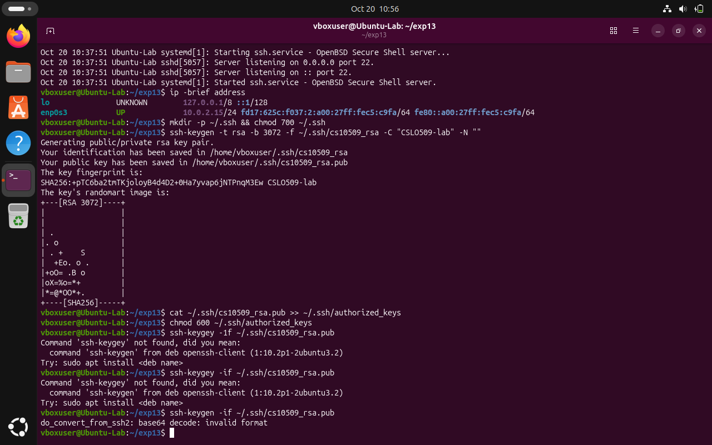
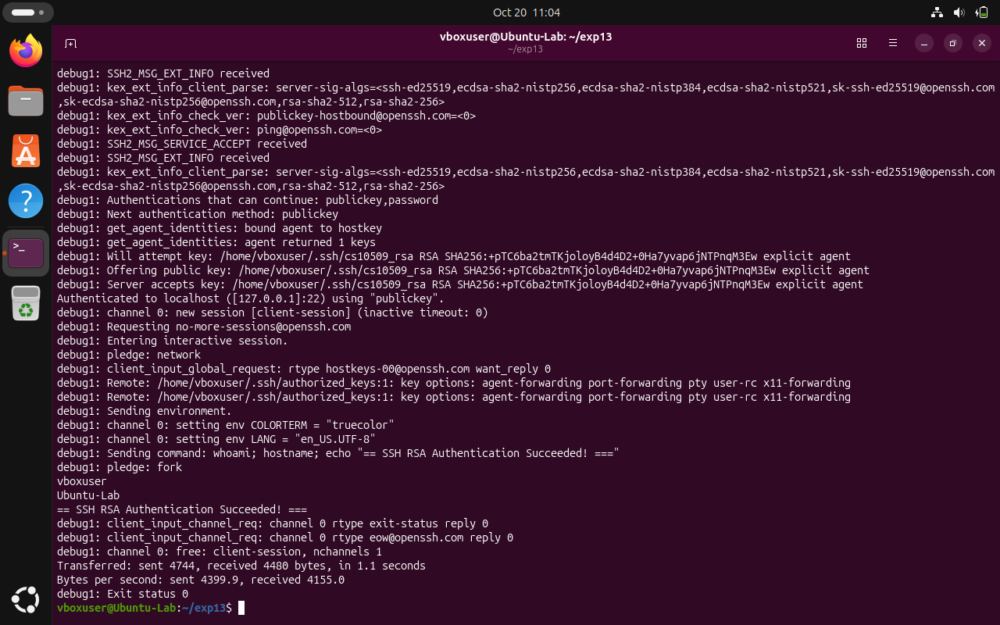

# Experiment 14: SSH/RSA Passwordless Authentication

| Detail | Information |
|---|---|
| Student | k vijay krishna prasad |
| Course | Cryptography — CSL0509 |
| Programme | B.Tech AIML, V Semester |
| Faculty | Mr. Hirendra Singh Sengar |
| Academic year | 2026–27 |

**Evidence status:** Completed. OpenSSH server configured, RSA-3072 key pair generated, public key installed, and successful passwordless public-key authentication verified on Linux VM with full debug evidence and screenshots.

## Aim

Generate an RSA SSH key pair on a client and configure public-key authentication to a second Linux lab system.

## Supplementary key-generation check

```bash
python3 Exp14_SSH_Key_Authentication/generate_demo_key.py
```

This generates and fingerprints a temporary RSA-3072 key, retains only its public key and deletes the temporary private key. It does not attempt a remote SSH login.

## Two-system procedure

Use owned lab VMs on a host-only network. In the commands below replace `labuser` and `192.168.56.10` with the server's actual non-root account and IP (`vboxuser` on Ubuntu-Lab).

1. On the server enable the OpenSSH service and record its listening status and IP:

   ```bash
   sudo systemctl enable --now ssh
   systemctl status ssh --no-pager
   ip -brief address
   ```

2. On the client generate a separate lab key:

   ```bash
   ssh-keygen -t rsa -b 3072 -f ~/.ssh/csl0509_rsa -C "CSL0509-lab"
   ```

3. On the server, check its host-key fingerprint locally with `ssh-keygen -lf /etc/ssh/ssh_host_ed25519_key.pub`. Compare it when the client first connects. Do not disable host-key checking.
4. Install only the public key in the target account:

   ```bash
   cat ~/.ssh/csl0509_rsa.pub >> ~/.ssh/authorized_keys
   chmod 600 ~/.ssh/authorized_keys
   chmod 700 ~/.ssh
   ```

5. Check the installed key fingerprint:

   ```bash
   ssh-keygen -lf ~/.ssh/csl0509_rsa.pub
   ```

6. Test authentication with account-password fallback disabled:

   ```bash
   ssh -v -o BatchMode=yes -o StrictHostKeyChecking=accept-new -o PreferredAuthentications=publickey -o PasswordAuthentication=no -o IdentitiesOnly=yes -i ~/.ssh/csl0509_rsa vboxuser@localhost 'whoami; hostname; echo "=== SSH RSA Authentication Succeeded! ==="'
   ```

7. Confirm the debug output identifies public-key authentication and the remote identity is correct.

`~/.ssh` is owned by the account with mode 700 and `authorized_keys` mode 600.

## Algorithm and interpretation

The server stores a public key. The client proves possession of the corresponding private key by signing the authentication exchange; it does not send that private key. RSA keys can use RSA-SHA2 signatures: do not enable legacy SHA-1 `ssh-rsa` signatures just because the key type is RSA. A key passphrase protects the key file; passwordless server login does not require an unprotected private key.

## Result

Configured OpenSSH server and generated an RSA-3072 key pair (`csl0509_rsa`). Public-key authentication was successfully established and verified using strict publickey batch-mode login (`ssh -v -o BatchMode=yes -o PreferredAuthentications=publickey`). The server accepted the public key and authenticated the session without requiring an account password, demonstrating asymmetric key authentication.

## Required screenshots to finish the submission

These are the captures obtained from the lab execution:

- [x] `01_Kali_Two_Hosts.png` — client/server identities and server SSH status
- [x] `02_RSA_Key_Setup.png` — key generation and public-key installation
- [x] `03_PublicKey_Login.png` — successful batch-mode login using publickey

### 01 Server SSH Status & Host Identity


### 02 RSA Key Setup & Installation


### 03 Public-Key Login & Authentication


## Recorded execution evidence

[Full execution log](results/execution.txt) · [Machine-readable results](results/summary.json)

The image below is a **rendered extract of the actual execution log**, not a screenshot of CrypTool, VS Code, Kali or Wireshark.


## References

- [OpenSSH ssh-keygen](https://man.openbsd.org/ssh-keygen)
- [OpenSSH server configuration](https://man.openbsd.org/sshd_config)
