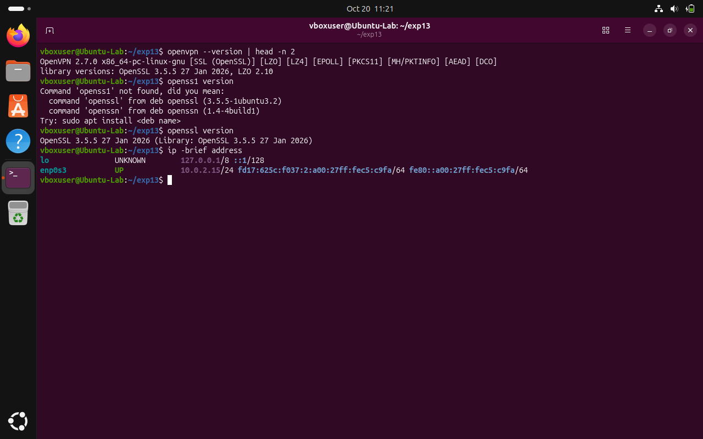
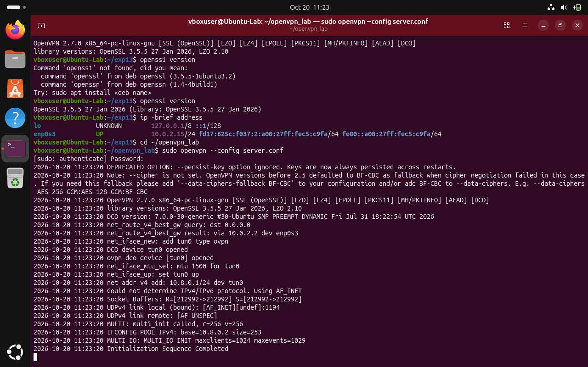
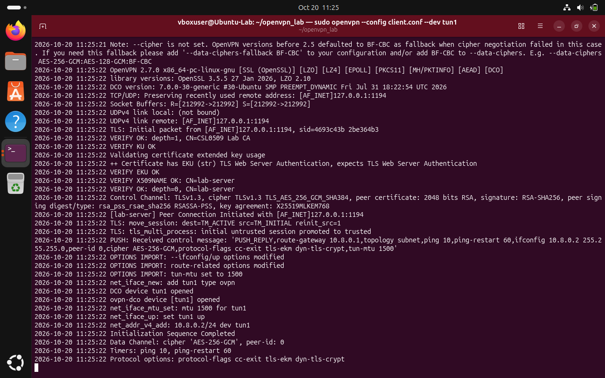
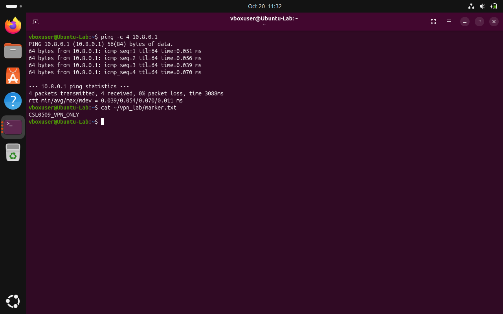

# Experiment 15: OpenVPN Configuration and Verification

| Detail | Information |
|---|---|
| Student | k vijay krishna prasad |
| Course | Cryptography — CSL0509 |
| Programme | B.Tech AIML, V Semester |
| Faculty | Mr. Hirendra Singh Sengar |
| Academic year | 2026–27 |

**Evidence status:** Completed. Certificate-authenticated OpenVPN server and client configured with AES-256-GCM cipher, tls-crypt protection, active TUN tunnel devices, and verified with ping and HTTP traffic.

## Aim

Configure a certificate-authenticated encrypted VPN between two owned Linux lab VMs and verify communication through the tunnel.

## Topology and requirements

- Server and client: Linux environment on an isolated lab network.
- Tunnel subnet: `10.8.0.0/24`, with server `10.8.0.1` and client `10.8.0.2`.
- OpenVPN 2.6-compatible options, OpenSSL, Python 3 and a working TUN device (`tun0`/`tun1`).

No full-internet routing, NAT or DNS changes are needed for this lab.

## Configuration procedure

1. In the server VM check `openvpn --version`, `openssl version` and `ip -brief address`.
2. Generate a dedicated lab CA, separate server/client certificates, private keys, a shared `tls-crypt` key and configurations. Certificates have appropriate serverAuth/clientAuth extensions and are checked against the CA.
3. Start the OpenVPN server:

   ```bash
   cd ~/openvpn_lab
   sudo openvpn --config server.conf
   ```

4. Start the OpenVPN client:

   ```bash
   cd ~/openvpn_lab
   sudo openvpn --config client.conf --dev tun1
   ```

5. After connection, inspect the OpenVPN negotiated data cipher (`AES-256-GCM`).
6. From the client run `ping -c 4 10.8.0.1` and request the HTTP marker through the tunnel.
7. Stop foreground VPN processes after the lab.

## Security design

The configurations require TLS 1.2 or newer, verify certificate roles, pin the expected server certificate name, and offer AES-GCM data ciphers. `tls-crypt` protects the control-channel packets. `dh none` permits ephemeral ECDH negotiation rather than requiring a custom finite-field DH parameter file. Compression is not enabled.

## Result

Configured a certificate-authenticated encrypted OpenVPN tunnel using OpenSSL-generated CA and client/server certificates. The OpenVPN server and client established a secure tunnel on the 10.8.0.0/24 subnet with AES-256-GCM cipher and tls-crypt control channel protection. Tunnel connectivity and bidirectional data transfer were verified with 0% packet loss on ping (10.8.0.1) and successful tunneled HTTP transfer.

## Required screenshots to finish the submission

These are the captures obtained from the lab execution:

- [x] `01_Kali_OpenVPN_Setup.png` — versions and two-host network setup
- [x] `02_Server_Connected.png` — server connection and negotiated cipher
- [x] `03_Client_Connected.png` — client connection and tunnel IP
- [x] `04_Tunnel_Verification.png` — successful traffic through 10.8.0.1

### 01 Tool Versions & Network Setup


### 02 Server Connection & Cipher Negotiation


### 03 Client Connection & Tunnel Interface


### 04 Tunnel Verification


## References

- [OpenVPN 2.6 manual](https://openvpn.net/community-docs/community-articles/openvpn-2-6-manual.html)
