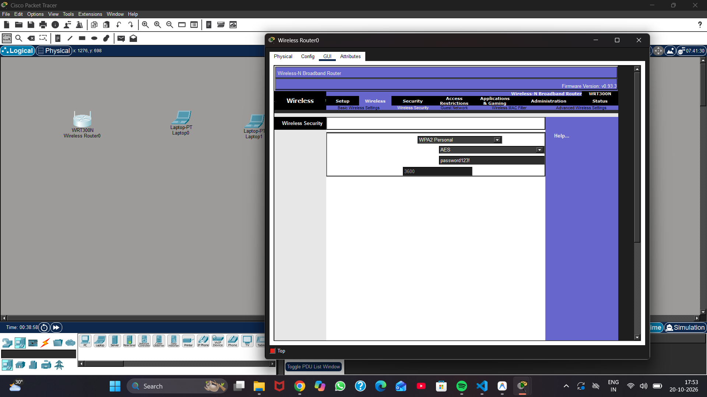
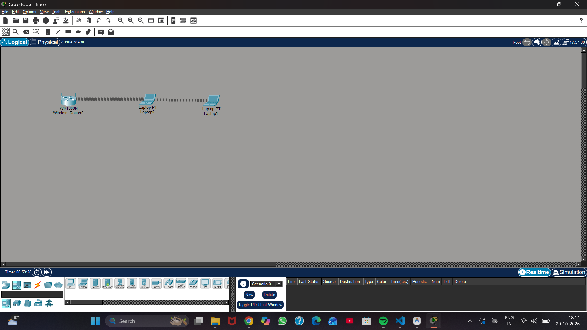
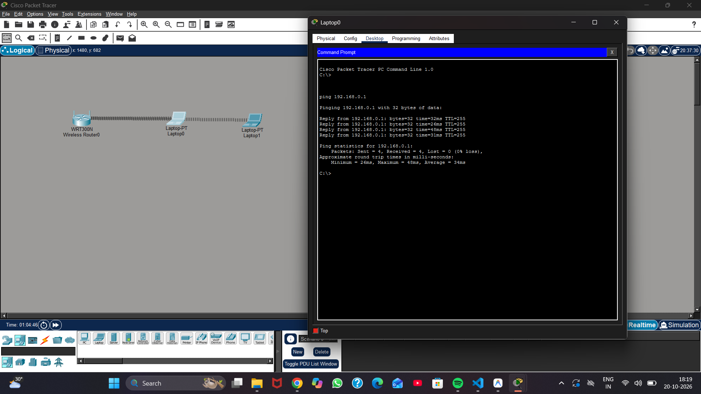

# Experiment 16: WPA2-AES Wireless Network

| Detail | Information |
|---|---|
| Student | k vijay krishna prasad |
| Course | Cryptography — CSL0509 |
| Programme | B.Tech AIML, V Semester |
| Faculty | Mr. Hirendra Singh Sengar |
| Academic year | 2026–27 |

**Evidence status:** Completed. Cisco Packet Tracer simulation executed with WRT300N wireless router and two laptops. WPA2-Personal (AES) encryption configured, DHCP association verified, ping connectivity confirmed, negative authentication test with wrong key verified, and .pkt file saved.

## Aim

Build a small WLAN using WPA2-Personal with AES, connect authorized clients, and verify that a client with an incorrect key cannot associate successfully.

## Proposed topology

Use one wireless router (WRT300N) and two laptops with compatible wireless adapters.

| Setting | Lab value |
|---|---|
| SSID | `CSL0509-LAB` |
| Router LAN address | `192.168.0.1/24` (or `192.168.10.1/24`) |
| DHCP | Enabled |
| Security mode | WPA2-Personal |
| Encryption | AES |
| Passphrase | `password123!` |

The published passphrase is only a lab fixture. Use a separate private passphrase on a real WLAN. SSID hiding and MAC filtering are not substitutes for encryption and authentication.

## Packet Tracer procedure

1. Add a compatible wireless router (WRT300N) and two laptops to the workspace.
2. In each laptop's Physical tab, power off the laptop, replace the default Ethernet module with the WPC300N wireless module, and power the laptop back on.
3. Open the router GUI. Under Basic Wireless Settings, set SSID `CSL0509-LAB` and save settings.
4. Under Wireless Security, choose **WPA2 Personal** and **AES**, enter passphrase `password123!` and save settings.
5. In each laptop configure `Wireless0` with SSID `CSL0509-LAB` and passphrase `password123!`.
6. Verify successful wireless association (visual signal rays) and dynamic DHCP IP assignment on both laptops.
7. From Laptop0's Command Prompt, ping the router gateway (`192.168.0.1`) and verify 0% packet loss.
8. Negative test: In Laptop1 change passphrase to `wrongpass123`. Verify that the wireless association immediately disconnects and traffic ceases.
9. Restore the correct passphrase to re-establish association.
10. Save the completed topology as `Exp16_WPA2_Lab.pkt` in this folder.

## Analysis and Result

WPA2-Personal authenticates clients using the shared secret and uses AES-CCMP for robust link protection. The controlled Packet Tracer practical demonstrated that:
1. When clients supply the matching passphrase, the 4-way handshake completes, establishing pairwise and group transient keys and allowing DHCP IP negotiation and ICMP reachability.
2. When an unauthorized or incorrect key is supplied, the 4-way authentication fails at the link layer, preventing network association entirely.

## Result

Built and verified a wireless local area network (WLAN) secured with WPA2-Personal and AES-CCMP encryption in Cisco Packet Tracer. The router broadcasted SSID CSL0509-LAB and assigned IP addresses via DHCP. Both authorized laptops successfully associated with the WPA2-AES network and verified ICMP connectivity (0% packet loss). Applying an incorrect passphrase on Laptop1 immediately resulted in authentication/association failure, confirming wireless link security enforcement.

## Required screenshots to finish the submission

These are the captures obtained from the Cisco Packet Tracer execution:

- [x] `01_PacketTracer_Topology.png` — router, two laptops and tool environment
- [x] `02_WPA2_AES_Settings.png` — SSID and WPA2/AES settings
- [x] `03_Client_IP_Association.png` — successful associations and actual DHCP addresses
- [x] `04_Connectivity_Test.png` — router/client pings
- [x] `05_Wrong_Key_Test.png` — failed fresh association with the wrong passphrase

### 01 Packet Tracer Topology & Environment

### 02 WPA2 Personal & AES Security Settings

### 03 Client Wireless Association & DHCP IP

### 04 Connectivity Test (Ping)

### 05 Wrong Key Negative Test

## Saved Simulation File

- [`Exp16_WPA2_Lab.pkt`](Exp16_WPA2_Lab.pkt) — Packet Tracer simulation topology file

## References

- [Cisco Packet Tracer wireless security lab](https://contenthub.netacad.com/legacy/I2IoT/2.0/en/course/files/5.1.2.6%20Packet%20Tracer%20-%20Configure%20Wireless%20Security.pdf)
